# MarrowQ Technical and Scientific Audit Report

**Date:** October 31, 2026  
**System:** MarrowQ (Multimodal, Quantum-Assisted Precision Medicine Decision-Support Platform)  
**Scope:** Complete Codebase Audit (`backend/app/`, `backend/tests/`, `frontend/src/`, Database, Architecture, Clinical Logic, ML Models, and Quantum Integrations)  
**Status:** Baseline Audit Completed for Phase 0  

---

## 1. Executive Summary

MarrowQ is currently an advanced translational research prototype for haematopoietic stem cell transplantation (HSCT) and leukaemia research. It combines a real paediatric HSCT cohort (UCI BMT dataset, $n=187$), a 156-qubit IBM Quantum Heron QPU workstation (`ibm_fez`), Qiskit Aer GPU-accelerated statevector engines, and an 8-agent clinical decision-support architecture.

While the user interface and quantum pipeline infrastructure are functional, an in-depth source code audit reveals **12 critical scientific, algorithmic, and architectural vulnerabilities (Issues A through L)**. These issues must be addressed before the platform can legitimately serve as a reliable, extensible precision medicine intelligence platform.

Most critically:
1. Classical models in the agentic clinical review are **hardcoded heuristic mathematical formulas** rather than trained scikit-learn models.
2. The quantum agent calculates cosine similarity to **two fixed manual vectors** in Hilbert space instead of executing an inferencing QSVM.
3. Neutrophil and platelet engraftment criteria violate international consensus definitions (ASTCT/EBMT/CIBMTR) by declaring engraftment on a **single laboratory reading** instead of requiring 3 consecutive daily measurements.
4. User role switching is purely **client-side in `localStorage`** without server-side authentication, session tokens, or RBAC enforcement.
5. The HLA matching interface uses a **1-to-10 slider** rather than real allele-level high-resolution HLA typing (A, B, C, DRB1, DQB1, DPB1).

---

## 2. In-Depth Audit of Known Issues (A through L)

### Issue A: Classical Prediction Agents Use Hardcoded Mathematical Formulas
* **Affected File:** [`backend/app/core/agents.py`](file:///c:/Users/nidhi/varsha/backend/app/core/agents.py#L152-L200) (`ClassicalMLPredictionService`)
* **Finding:** Rather than loading trained machine learning models serialized during benchmark training (e.g. from `backend/app/artifacts/` using `joblib`), the prediction service computes probabilities using fixed algebraic formulas:
  ```python
  # Line 163-170 in backend/app/core/agents.py:
  score_lr = 1.0 / (1.0 + np.exp(-(-2.2 + 0.0035 * anc + 0.28 * cd34)))
  p_lr = float(np.clip(score_lr, 0.05, 0.96))
  p_rf = float(np.clip(0.35 + (0.50 if anc > 300 else 0.15) + (0.15 if cd34 >= 5.0 else 0.0), 0.10, 0.95))
  p_svm = float(np.clip(0.5 * (p_lr + p_rf) + 0.02, 0.08, 0.94))
  ```
  The code presents these formulas as `LogisticRegression_v1.4`, `RandomForest_n100_v2.0`, and `SVC_rbf_C1.0_v1.2` with fake training baselines (`CIBMTR 2024 Retrospective`).
* **Clinical Risk:** Extremely high. Clinicians reviewing the "Multi-Agent Clinical Review" are misled into believing three trained, validated ML models have achieved consensus.
* **Remediation Plan:**
  - Create a persistent model loader that loads real scikit-learn pipeline artifacts (`preprocessor.joblib`, `model_logistic.joblib`, `model_random_forest.joblib`, `model_rbf_svm.joblib`) trained on the genuine UCI BMT cohort.
  - If a model artifact is missing or untrained, explicitly report `status: "UNAVAILABLE"` with zero probability imputation.

---

### Issue B: Quantum Agent Uses Fixed Manual Reference Anchors
* **Affected File:** [`backend/app/core/agents.py`](file:///c:/Users/nidhi/varsha/backend/app/core/agents.py#L201-L269) (`QuantumMLPredictionService`)
* **Finding:** The quantum agent evaluates quantum kernel circuits against two hardcoded 2D points:
  ```python
  # Line 215-218 in backend/app/core/agents.py:
  reference_anchors = np.array([
      [3.85, 4.12], # Engrafted anchor
      [1.20, 1.45]  # Delayed anchor
  ])
  ...
  exp_engraft = np.exp(fidelity_engrafted * 3.0)
  exp_delay = np.exp(fidelity_delayed * 3.0)
  q_prob = float(exp_engraft / (exp_engraft + exp_delay))
  ```
* **Clinical Risk:** The quantum prediction is presented as a "Quantum-Kernel SVM (ZZFeatureMap)" trained on clinical outcomes, when in reality it is an arbitrary 2-point softmax heuristic.
* **Remediation Plan:**
  - Connect `QuantumMLPredictionService` to the trained QSVM pipeline in `backend/app/core/quantum/qsvm_cv.py` or label it explicitly as `Experimental 2-State Quantum Fidelity Probe (Non-Diagnostic)`.
  - Never present the reference similarity score as a calibrated probability of engraftment.

---

### Issue C: Arbitrary Fallback Values for Missing Laboratory Data
* **Affected Files:** [`backend/app/core/agents.py`](file:///c:/Users/nidhi/varsha/backend/app/core/agents.py#L116-L121), [`backend/app/core/trajectory.py`](file:///c:/Users/nidhi/varsha/backend/app/core/trajectory.py#L50)
* **Finding:** When a patient is missing lab values during feature engineering, the code falls back to hardcoded defaults:
  ```python
  age = float(patient_record.get("age", 45))
  cd34 = float(patient_record.get("cell_dose_cd34", 5.0))
  anc = float(current_labs.get("anc", 250.0))
  plt = float(current_labs.get("platelets", 35000.0))
  ```
* **Clinical Risk:** If a patient has never had an ANC or platelet count drawn, the system silently manufactures numbers (ANC 250, platelets 35,000) and feeds them into ML models.
* **Remediation Plan:**
  - Enforce a strict **Zero-Imputation Policy** for live clinical review. If required labs are missing, the review must halt at Agent 1 (Data Quality) with an explicit error: `"Cannot perform engraftment assessment: Missing required lab observations (ANC, Platelets)"`.

---

### Issue D: Patient-Facing Reports Containing Fixed Laboratory Copy
* **Affected File:** [`backend/app/core/agents.py`](file:///c:/Users/nidhi/varsha/backend/app/core/agents.py#L467-L476) (`ClinicalReportAgent`)
* **Finding:** The patient-friendly report template uses static thresholds and boilerplate text without reflecting trend kinetics, fever status, or transfusion history:
  ```python
  anc, plt = patient_record["current_anc"], patient_record["current_plt"]
  patient_report = (
      f"Here is your transplant recovery update for Day +{patient_record['days_post_tx']}:\n\n"
      + (f"• Infection-fighting white cells (neutrophils): your latest count is {anc:,.0f}, above the 500 mark doctors look for.\n"
         if anc >= 500 else ...)
  )
  ```
* **Clinical Risk:** The text gives false reassurance if ANC $\ge 500$ for a single day followed by severe sepsis or graft failure.
* **Remediation Plan:**
  - Refactor report generation to incorporate longitudinal validation: verify whether the count has been sustained for 3 consecutive days, report platelet transfusion independence, and include explicit clinician verification disclaimers.

---

### Issue E: Recovery Trajectories Use Generic Predefined Sigmoid Parameters
* **Affected File:** [`backend/app/core/trajectory.py`](file:///c:/Users/nidhi/varsha/backend/app/core/trajectory.py#L6-L69)
* **Finding:** The recovery trajectory generator uses a deterministic logistic growth equation with hardcoded parameters for all patients:
  ```python
  pred_anc = sigmoid(day, t0=expected_anc_engraft_day, k=0.45, lower=30.0, upper=2800.0)
  pred_plt = sigmoid(day, t0=expected_plt_engraft_day, k=0.35, lower=11000.0, upper=145000.0)
  ```
  The uncertainty bands are calculated with a linear formula: `0.05 + 0.02 * days_from_latest`.
* **Clinical Risk:** Presenting this generic sigmoid curve with "95% confidence intervals" misleads clinicians into believing it is a patient-specific Bayesian or Gaussian Process trajectory forecast.
* **Remediation Plan:**
  - Clearly label the curve as an `Empirical Population Reference Curve (Non-Personalised)` until a genuine Bayesian longitudinal model (e.g. Gaussian Process or Mixed-Effects Model) trained on longitudinal HSCT data is activated.

---

### Issue F: Milestone Logic Violates International Consensus Engraftment Criteria
* **Affected File:** [`backend/app/core/trajectory.py`](file:///c:/Users/nidhi/varsha/backend/app/core/trajectory.py#L97-L111)
* **Finding:**
  - **ASTCT/EBMT/CIBMTR Definition for Neutrophil Engraftment:** The first of **three consecutive days** with Absolute Neutrophil Count (ANC) $\ge 0.5 \times 10^9/\text{L}$ ($500/\mu\text{L}$) following the post-transplant nadir.
  - **ASTCT/EBMT/CIBMTR Definition for Platelet Engraftment:** The first of **three consecutive days** with platelet count $\ge 20 \times 10^9/\text{L}$ ($20,000/\mu\text{L}$) or $\ge 50 \times 10^9/\text{L}$ ($50,000/\mu\text{L}$) **without platelet transfusions for 7 consecutive days**.
  - **Actual Code Implementation:**
    ```python
    # Line 100-103:
    for day in sorted(anc_observed.keys()):
        if day > 0 and anc_observed[day] >= 500:
            anc_engrafted_day = day
            break
    ```
    The code marks engraftment as `COMPLETED` on the **very first single observation** $\ge 500/\mu\text{L}$! A single transient spike from G-CSF administration or lab error is falsely flagged as successful engraftment.
* **Clinical Risk:** Catastrophic in real clinical care. Premature declaration of engraftment could lead to premature cessation of prophylactic antibiotics or antifungal agents.
* **Remediation Plan:**
  - Rewrite the milestone evaluation engine to strictly enforce 3 consecutive daily counts $\ge 500/\mu\text{L}$ for ANC.
  - Require explicit verification of 7-day transfusion independence for platelet engraftment ($\ge 20,000/\mu\text{L}$).

---

### Issue G: Diagnostic Ensemble Averages Experimental Quantum and Classical Models
* **Affected File:** [`backend/app/core/agents.py`](file:///c:/Users/nidhi/varsha/backend/app/core/agents.py#L271-L325) (`IndependentPredictionValidationAgent`)
* **Finding:** The consensus validation agent computes an unweighted arithmetic mean across all model outputs:
  ```python
  for mname, mdata in classical_outputs.items():
      probs.append(p)
  if "probability" in quantum_output:
      probs.append(qp)
  mean_p = float(np.mean(probs))
  var_p = float(np.var(probs))
  ```
* **Clinical Risk:** The 2-anchor experimental quantum probe is given equal 25% voting weight against classical models. If classical models predict 85% probability but the experimental quantum probe outputs 20%, the system flags `"Model Disagreement Detected"`.
* **Remediation Plan:**
  - Separate classical validated clinical prediction from experimental quantum exploratory research.
  - The primary diagnostic review must be driven by validated classical ensemble models, while the quantum kernel output is displayed in a dedicated `Exploratory Quantum Research Track`.

---

### Issue H: Frontend Fallback Data Appearing as Genuine Patient Information
* **Affected Files:** [`frontend/src/data/observations.ts`](file:///c:/Users/nidhi/varsha/frontend/src/data/observations.ts), [`frontend/src/data/organs.ts`](file:///c:/Users/nidhi/varsha/frontend/src/data/organs.ts)
* **Finding:** In several views, when API data fails to load or is empty, mock default structures are returned to prevent blank screens.
* **Clinical Risk:** Users may mistake fallback UI values for a patient's real medical history.
* **Remediation Plan:**
  - Replace silent fallback defaults with explicit empty states (`<EmptyWard />`, `<NoObservationsRecorded />`) with clear prompts to record genuine clinical observations.

---

### Issue I: Synthetic Records, Approvals, and Telemetry Need Provenance Badging
* **Affected Files:** [`backend/app/core/synthetic.py`](file:///c:/Users/nidhi/varsha/backend/app/core/synthetic.py), [`backend/app/core/patients.py`](file:///c:/Users/nidhi/varsha/backend/app/core/patients.py), [`frontend/src/views/HospitalAnalyticsView.tsx`](file:///c:/Users/nidhi/varsha/frontend/src/views/HospitalAnalyticsView.tsx)
* **Finding:** Synthetic records generated by `generate_hsct_synthetic_dataset` and example patients from the UCI cohort were previously displayed alongside genuine clinical entries without continuous, persistent visual provenance markers.
* **Remediation Plan:**
  - Enforce persistent provenance tagging across database entities: `data_mode: "synthetic" | "cohort_example" | "clinical_intake"`.
  - Display non-removable warning badges in the UI on all synthetic and example records.

---

### Issue J: Graft Comparison Lacks Complete High-Resolution HLA Matching
* **Affected Files:** [`backend/app/core/patients.py`](file:///c:/Users/nidhi/varsha/backend/app/core/patients.py), [`frontend/src/views/PredictionView.tsx`](file:///c:/Users/nidhi/varsha/frontend/src/views/PredictionView.tsx)
* **Finding:** Graft comparison allows selecting `'10/10'`, `'9/10'`, `'8/10'`, or `'7/10'` as a plain string dropdown. It does not parse or evaluate high-resolution 2-field HLA typing:
  - Class I: HLA-A, HLA-B, HLA-C
  - Class II: HLA-DRB1, HLA-DQB1, HLA-DPB1
  - Permissive vs non-permissive DPB1 mismatches (T-cell epitope TCE groups).
  - Donor-specific antibodies (DSA) and Mean Fluorescence Intensity (MFI).
  - ABO major/minor incompatibilities.
* **Clinical Risk:** Transplant success depends entirely on exact allele-level matching and mismatch directionality (host-versus-graft vs graft-versus-host vector). A simple 10/10 string abstraction is inadequate for genuine clinical decision-support.
* **Remediation Plan:**
  - Build a dedicated `DonorCompatibilityEngine` supporting 12-allele high-resolution HLA matching, DSA evaluation, ABO mismatch classification, and NMDP/EBMT donor selection algorithms.

---

### Issue K: Client-Side Role Switching Without Backend Authentication or RBAC
* **Affected Files:** [`frontend/src/App.tsx`](file:///c:/Users/nidhi/varsha/frontend/src/App.tsx#L28), [`backend/app/api/routes.py`](file:///c:/Users/nidhi/varsha/backend/app/api/routes.py)
* **Finding:** Role switching is implemented via `usePersistentState<UserRole>('marrowq.role', 'doctor')`. Any user can open the browser console and type `localStorage.setItem('marrowq.role', 'doctor')` or `'hospital_admin'` to access all clinical views. The backend API has **no authentication headers, no JWT tokens, and no authorization decorators** (`Depends(get_current_user)`).
* **Security & Privacy Risk:** Severe vulnerability. Patient health information (PHI) is exposed via unprotected REST endpoints (`/api/patients`, `/api/patients/{id}/progress`, `/api/predictions`).
* **Remediation Plan:**
  - Implement real backend authentication: password hashing with `argon2` or `bcrypt`, JWT access tokens, role-based authorization dependencies (`require_role(["doctor", "hospital_admin"])`), and fine-grained patient record access control.

---

### Issue L: 3D Anatomical Visualisation Requires Clear Educational Labeling
* **Affected File:** [`frontend/src/components/OrganViewer3D.tsx`](file:///c:/Users/nidhi/varsha/frontend/src/components/OrganViewer3D.tsx)
* **Finding:** The 3D organ view renders generic anatomical `.glb` meshes (Heart, Liver, Bone Marrow, Stem Cell). Next to the 3D canvas, real patient lab values (ANC, Platelets, ALT, Bilirubin) are displayed. A clinician or patient might assume the 3D model is reconstructed from the patient's actual CT/MRI scans.
* **Remediation Plan:**
  - Add prominent clinical metadata badges directly on the 3D canvas: `"Educational Anatomical Reference Model — Not Patient-Specific Imaging or Pathology"`.
  - When real imaging is uploaded (Phase 2/4), route it to a dedicated DICOM/Pathology viewing viewport.

---

## 3. Repository Architecture & File Matrix

| Component | Path | Current Status | Required Action for Precision Medicine Expansion |
| :--- | :--- | :--- | :--- |
| **API Endpoints** | `backend/app/api/routes.py` | Working, unauthenticated | Add JWT auth, RBAC guards, modular router split |
| **Compute Worker** | `backend/app/api/compute_routes.py` | Working GPU job queue | Expand to distributed Celery/Redis queue for multimodal ML |
| **Clinical Agents** | `backend/app/core/agents.py` | 8 bounded agents, heuristic models | Replace formulas with scikit-learn model artifacts; isolate quantum track |
| **Classical ML** | `backend/app/core/classical.py` | Scikit-learn pipelines exist | Package trained models into artifact bundle with schema metadata |
| **Quantum Engine** | `backend/app/core/quantum/` | GPU simulator, Heron noisy sim | Integrate Qiskit Runtime SamplerV2; add barren plateau monitoring |
| **IBM Quantum** | `backend/app/core/ibm_quantum.py` | Hardware client authenticated | Retain quota guard; add error mitigation (twirling, DD, ZNE) |
| **Trajectory Engine** | `backend/app/core/trajectory.py` | Fixed sigmoid; single-day engraftment | Enforce 3-day consecutive ANC $\ge 500$; 7-day transfusion independence |
| **Database** | `backend/app/core/database.py` | SQLite WAL mode; 9 tables | Migrate to expanded 22-entity schema with migrations |
| **Frontend Root** | `frontend/src/App.tsx` | Hash router, client-side role | Add session auth, login screen, expanded navigation |
| **Navigation** | `frontend/src/navigation.ts` | 11 tabs, 5 groups | Expand to Patient Care, Research, Hospital sections |
| **Views** | `frontend/src/views/` | 10 view components | Add Biological Data, Disease Assessment, Donor Match views |

---

## 4. Comprehensive Audit Findings Summary

```mermaid
graph TD
    A["MarrowQ Audit Findings"] --> B["Clinical Correctness"]
    A --> C["Algorithmic Rigour"]
    A --> D["Security & Privacy"]
    A --> E["Architectural Modularity"]

    B --> B1["Issue F: Single-day engraftment bug"]
    B --> B2["Issue C: Silently imputing missing labs"]
    B --> B3["Issue J: Oversimplified 10/10 HLA string"]

    C --> C1["Issue A: Heuristic formulas in agents"]
    C --> C2["Issue B: 2-point quantum similarity heuristic"]
    C --> C3["Issue G: Equal weighting of experimental quantum"]
    C --> C4["Issue E: Rigid sigmoid recovery curves"]

    D --> D1["Issue K: Zero backend authentication / RBAC"]
    D --> D2["Issue H/I: Synthetic data provenance clarity"]

    E --> E1["Monolithic routes.py needing modular routers"]
    E --> E2["Single CSV parser needing multimodal adapters"]
    E --> E3["Database schema lacking multi-disease entities"]
```



---

## 5. Audit Conclusion & Phase Transition

The technical audit is complete. All 12 issues (A–L) have been catalogued with exact root causes and verification paths. The platform provides a solid baseline for Phase 1 fixes and subsequent architectural expansion into a multimodal precision medicine intelligence platform.
