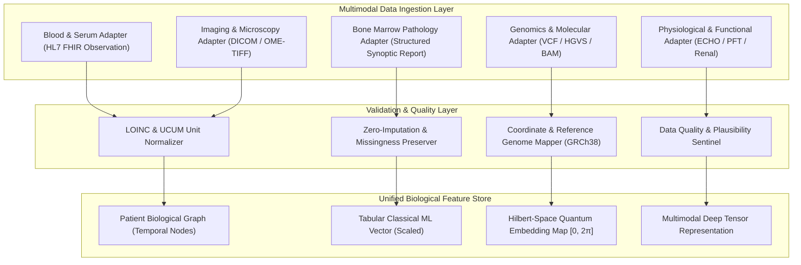

# MarrowQ Biological Data Research & Multimodal Architecture

**Date:** October 31, 2026  
**Scope:** Multimodal Biological Data Ingestion, Extraction, Normalization, and Provenance  
**Modalities Covered:** Haematology Blood Counts, Bone Marrow Aspirate & Biopsy, Flow Cytometry, Cytogenetics & FISH, Targeted Molecular NGS, Histopathology Whole-Slide Imaging, and Diagnostic Radiological Imaging (DICOM)  

---

## 1. Multimodal Biological Record Architecture

A true precision medicine intelligence engine cannot treat blood counts, molecular mutations, and whole-slide pathology images as flat CSV rows. MarrowQ establishes a **Multimodal Biological Record (MBR)** architecture composed of five decoupled, specialized biological adapters feeding into a unified patient representation.

---

## 2. Modality Specifications & Data Contracts

### 2.1 Modality A: Blood Analysis (Haematology & Biochemistry)
* **Standard Identifiers:** LOINC codes for observations; UCUM codes for units.
* **Key Parameters:**
  - Absolute Neutrophil Count (ANC) (`LOINC 751-8`): cells/$\mu\text{L}$ ($10^6/\text{L}$). Reference range: $1,500\text{--}8,000/\mu\text{L}$.
  - Platelet Count (`LOINC 777-3`): $\times 10^3/\mu\text{L}$ ($10^9/\text{L}$). Reference range: $150\text{--}450\times 10^3/\mu\text{L}$.
  - Haemoglobin (Hb) (`LOINC 718-7`): $\text{g/dL}$. Reference range: $12.0\text{--}17.5\text{ g/dL}$.
  - Total White Blood Cells (WBC) (`LOINC 6690-2`): $\times 10^3/\mu\text{L}$. Reference range: $4.0\text{--}11.0\times 10^3/\mu\text{L}$.
  - Absolute Lymphocyte Count (ALC) (`LOINC 731-0`): cells/$\mu\text{L}$.
  - Absolute Monocyte Count (AMC) (`LOINC 742-7`): cells/$\mu\text{L}$.
  - Serum Ferritin (`LOINC 2276-4`): $\text{ng/mL}$ (acute phase reactant & iron overload in HSCT).
  - C-Reactive Protein (CRP) (`LOINC 1988-5`): $\text{mg/L}$.
  - Procalcitonin (`LOINC 33959-8`): $\text{ng/mL}$ (distinguishes bacterial sepsis from engraftment syndrome).
* **Ingestion Protocol:** Automatic time-stamped series; enforces non-monotonic day mapping and specimen verification.

### 2.2 Modality B: Bone Marrow Analysis (Morphology, Aspirate, Biopsy)
* **Specimen Sources:** Posterior iliac crest aspirate, trephine core biopsy.
* **Key Clinical Fields:**
  - Overall Cellularity (%): Normal expected cellularity $= (100 - \text{age}) \pm 10\%$.
  - Myeloid-to-Erythroid (M:E) Ratio: Normal $2:1\text{ to }4:1$.
  - Blast Percentage (%): Quantified via morphology on $\ge 500$ nucleated cells and CD34/CD117 flow cytometry. Blasts $\ge 20\%$ defines acute leukaemia (AML/ALL); blasts $5\text{--}19\%$ defines MDS with excess blasts (MDS-EB).
  - Myelofibrosis Grade (WHO 2016/2022):
    - MF-0: Linear reticulin without intersections.
    - MF-1: Loose network of intersections.
    - MF-2: Diffuse and dense increase in reticulin with extensive intersections, focal collagen.
    - MF-3: Diffuse and dense reticulin with extensive collagenisation and osteosclerosis.
  - Ring Sideroblasts (% on Prussian Blue Iron Stain): $\ge 5\%$ or $\ge 15\%$ relevant for $SF3B1$-mutated MDS.
  - Flow Cytometric Immunophenotyping: Markers: CD34, CD117, CD33, CD13, HLA-DR, CD14, CD64, CD19, CD10, CD20, CD3, CD7, CD56.
  - Minimal Residual Disease (MRD): Limit of detection $10^{-4}$ ($0.01\%$) for 8-color/10-color multiparameter flow cytometry; $10^{-6}$ ($0.0001\%$) for clonoSEQ NGS or digital droplet PCR (ddPCR).

### 2.3 Modality C: Genomic & Molecular Analysis (DNA / RNA / Cytogenetics)
* **Reference Genome Coordinate System:** Human genome build **GRCh38 / hg38** (with automated LiftOver support from GRCh37).
* **Variant Nomenclature:** Standard Human Genome Variation Society (**HGVS**) recommendations (e.g. `p.Val600Glu`, `c.1799T>A`).
* **Input Formats:**
  - Variant Call Format (**VCF v4.2 / v4.3**): Filtered passing variants with depth ($DP \ge 100$), variant allele fraction ($VAF \ge 0.02$).
  - Cytogenetic Karyotyping (ISCN 2020 format, e.g. `46,XY,t(8;21)(q22;q22.1)[18]/46,XY[2]`).
  - Fluorescence In Situ Hybridization (FISH) probe summaries.
* **Targeted Gene Panels:**
  - Myeloid 54-Gene Panel: $TP53, NPM1, FLT3, DNMT3A, IDH1, IDH2, TET2, ASXL1, RUNX1, SRSF2, U2AF1, SF3B1, ZRSR2, CEBPA, WT1, KIT, NRAS, KRAS, PTPN11, CBL, EZH2, BCOR, STAG2, PHF6, GATA2, CALR, MPL, JAK2, CSF3R, SETBP1$.
  - Lymphoid Panel: $NOTCH1, FBXW7, MYD88, CXCR4, BRAF, BTK, PLCG2, STAT3, STAT5B$.
  - Pharmacogenomics Panel: $TPMT, NUDT15, DPYD, CYP2C19, CYP2D6, CYP2C9, VKORC1, UGT1A1, SLCO1B1, HLA-B*57:01, HLA-A*31:01$.

### 2.4 Modality D: Pathology Whole-Slide Imaging & Radiology (DICOM)
* **Digital Pathology:** Whole-Slide Images (WSI) in pyramidal tiled TIFF / OME-TIFF / SVS format:
  - Magnification: $20\times$ (0.50 $\mu\text{m/pixel}$) and $40\times$ (0.25 $\mu\text{m/pixel}$).
  - Stains: H&E, Giemsa, Wright-Giemsa, Prussian blue, Reticulin silver stain.
* **Radiological Imaging (DICOM PS 3.0):**
  - Modalities: CT (Computed Tomography), MRI (Magnetic Resonance Imaging), PET-CT ($^{18}\text{F-FDG}$).
  - De-identification Protocol: Complete removal of DICOM Tag Group 0010 (PatientName, PatientID, PatientBirthDate, PatientAddress) per DICOM PS 3.15 Annex E (Basic Application Level Confidentiality Profile).
  - Clinical Indications in HSCT: High-Resolution Chest CT (HRCT) for invasive fungal infections (halo sign, air-crescent sign); Liver MRI / T2* R2 for hepatic iron overload (hemosiderosis); 18F-FDG PET-CT for lymphoma response (Lugano classification / Deauville 5-point score).

---

## 3. Strict Preprocessing & Missing Data Policies

1. **Zero-Imputation Rule for Critical Diagnostic Variables:**
   - Under no circumstances will MarrowQ impute missing laboratory counts, karyotype results, or molecular mutations with arbitrary synthetic numbers (e.g. defaulting missing ANC to 250 or assuming wild-type $TP53$).
   - If a model requires a variable that has not been measured, the prediction service must flag: `MISSING_PREREQUISITE_FEATURE: [feature_name]`.
2. **Deterministic Feature Scaling for Classical ML:**
   - Preprocessors (`StandardScaler`, `RobustScaler`, `OneHotEncoder`) must be fit **exclusively on the training cohort** inside a strict scikit-learn `Pipeline`.
   - Never fit scalers on the full dataset before splitting.
3. **Phase-Angle Normalization for Quantum Computing:**
   - For $n$-qubit quantum feature maps ($ZZFeatureMap$), feature vectors $x = [x_1, \dots, x_n]$ are min-max normalized and scaled strictly into the phase rotation domain $[0, 2\pi]$:
     $$x_j^{\text{quantum}} = 2\pi \cdot \frac{x_j - x_j^{\min}}{x_j^{\max} - x_j^{\min}}$$
   - Prevents phase wrap-around ambiguities and preserves non-linear fidelity in Hilbert space.

