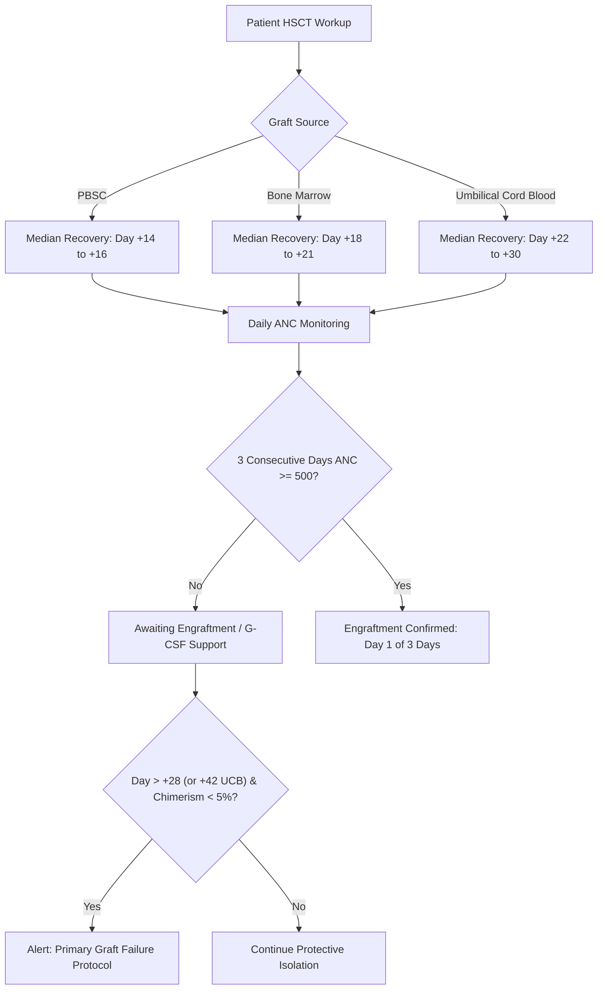

# MarrowQ Clinical Evidence Registry

**Date:** October 31, 2026  
**Scope:** Standardized Clinical Evidence Base, Regulatory Guidelines, Decision Rules, and Evidence Grading  
**Authoritative Frameworks:** Oxford Centre for Evidence-Based Medicine (CEBM), GRADE, CPIC, ASTCT, EBMT, NCCN, WHO  

---

## 1. Evidence Hierarchy and Grading System

MarrowQ categorizes all clinical decision-support rules into four rigorous evidence levels:

| Evidence Level | Evidence Source Definition | Permitted System Actions |
| :--- | :--- | :--- |
| **Level I (A)** | High-quality systematic reviews, meta-analyses of randomized controlled trials (RCTs), multi-centre prospective trials, or CPIC Level A clinical guidelines. | Actionable clinical alerts with explicit guideline citations; dose modification warnings. |
| **Level II (B)** | Well-designed prospective observational studies, large multi-centre disease registries (CIBMTR, EBMT), or CPIC Level B recommendations. | Clinical context suggestions, risk factor highlighting, and prognostic score calculations. |
| **Level III (C)** | Retrospective single-centre cohort studies, consensus committee opinions, or pilot prospective trials. | Educational context, comparative benchmarking; flagged with explicit single-centre disclaimer. |
| **Level IV (Experimental)** | Machine learning predictions, quantum kernel algorithms, preclinical models, or exploratory data analyses. | Research hypothesis generation only. Model outputs must be labeled `Research Evaluation — Not Clinical Advice`. |

---

## 2. Master Clinical Rules & Indications Registry

### 2.1 Transplant Conditioning & Engraftment Rules

| Rule Identifier | Clinical Domain | Trigger Condition | System Action & Output | Supporting Evidence Citation |
| :--- | :--- | :--- | :--- | :--- |
| **`RULE-HSCT-001`** | Neutrophil Engraftment | ANC $\ge 500/\mu\text{L}$ on 3 consecutive daily lab draws following post-transplant nadir. | Mark milestone `m3_anc_engraftment` as `COMPLETED`. Set `actual_day` to the first of the 3 days. | ASTCT/EBMT Consensus Criteria; Blood 2018;131(15):1658-1668. |
| **`RULE-HSCT-002`** | Platelet Engraftment | Platelets $\ge 20,000/\mu\text{L}$ on 3 consecutive daily draws without platelet transfusion for $\ge 7$ consecutive days. | Mark milestone `m4_plt_engraftment` as `COMPLETED`. Report transfusion-free interval. | EBMT Handbook 2022; Chapter 12: Recovery and Milestones. |
| **`RULE-HSCT-003`** | Primary Graft Failure Alert | Recipient Day $\ge +28$ (or Day $\ge +42$ for cord blood) with persistent ANC $< 500/\mu\text{L}$ and donor chimerism $< 5\%$. | Fire Level I Critical Alert: `PRIMARY_GRAFT_FAILURE_SUSPECTED`. Prompt for immediate bone marrow biopsy, donor chimerism STR, and re-transplant evaluation. | CIBMTR Engraftment Guidelines; Biol Blood Marrow Transplant 2019;25(11):e348-e355. |
| **`RULE-HSCT-004`** | Secondary Graft Failure Alert | Recipient previously engrafted (ANC $\ge 500/\mu\text{L}$ for 3 days), now presenting with ANC $< 500/\mu\text{L}$ for $\ge 7$ consecutive days or donor chimerism dropping $< 90\%$. | Fire Level I Alert: `SECONDARY_GRAFT_FAILURE_ALERT`. Recommend viral PCR workup (CMV, HHV-6, EBV, Parvovirus B19) and bone marrow evaluation. | Olsson et al., Bone Marrow Transplant 2013;48(12):1501-1507. |
| **`RULE-HSCT-005`** | Febrile Neutropenia Precaution | Patient has ANC $< 500/\mu\text{L}$ (or $< 1000/\mu\text{L}$ with predicted nadir) and recorded body temperature $\ge 38.0^\circ\text{C}$ ($\ge 100.4^\circ\text{F}$) for $\ge 1\text{ hr}$ or single spike $\ge 38.3^\circ\text{C}$. | Fire Urgent Level I Alert: `FEBRILE_NEUTROPENIA_URGENT`. Recommend immediate blood cultures $\times 2$ (catheter and peripheral) and empiric broad-spectrum antipseudomonal $\beta$-lactam within 60 minutes. | IDSA Clinical Practice Guideline for Neutropenic Patients; Clin Infect Dis 2011;52(4):e56-e93. |

---

### 2.2 Pharmacogenomic Medication Suitability Rules (CPIC Level A)

| Rule Identifier | Gene / Allele | Drug | Clinical Action & Guideline Recommendation | CPIC Level & Evidence Reference |
| :--- | :--- | :--- | :--- | :--- |
| **`RULE-PGX-001`** | $TPMT$ / $NUDT15$ Poor Metaboliser | 6-Mercaptopurine, Azathioprine, 6-Thioguanine | **Substantial dose reduction required:** For TPMT or NUDT15 poor metabolisers, reduce starting dose by $90\%$ (administer 10% of normal dose 3 times per week). High fatal myelosuppression risk. | CPIC Guideline for Thiopurines; Clin Pharmacol Ther 2019;105(5):1095-1105. |
| **`RULE-PGX-002`** | $DPYD$ $*2A, *13, c.2846A>T$, HapB3 | 5-Fluorouracil, Capecitabine | **Avoid or reduce dose:** For DPYD poor metabolisers (activity score 0), avoid fluoropyrimidines entirely. For intermediate metabolisers (activity score 1.0–1.5), reduce initial dose by 50%. Lethal systemic toxicity risk. | CPIC Guideline for Fluoropyrimidines; Clin Pharmacol Ther 2018;103(2):210-216. |
| **`RULE-PGX-003`** | $CYP2C19$ $*2/*2, *3/*3$ (Poor Metaboliser) | Voriconazole | **Avoid voriconazole:** Markedly elevated drug concentrations and excessive hepatotoxicity/neurotoxicity risk. Recommend an alternative agent not primarily metabolised by CYP2C19 (isavuconazole, liposomal amphotericin B). | CPIC Guideline for Voriconazole; Clin Pharmacol Ther 2017;102(1):45-51. |
| **`RULE-PGX-004`** | $CYP2C19$ $*17/*17$ (Ultrarapid Metaboliser) | Voriconazole | **Sub-therapeutic risk:** Rapid metabolism results in failure to attain therapeutic trough concentrations ($< 1.0\text{ mg/L}$); risk of fatal breakthrough invasive aspergillosis. Use alternative or mandatory therapeutic drug monitoring (TDM). | CPIC Guideline for Voriconazole; Clin Pharmacol Ther 2017;102(1):45-51. |
| **`RULE-PGX-005`** | $CYP2D6$ Poor or Ultrarapid Metaboliser | Codeine, Tramadol | **Contraindicated:** Poor metabolisers experience analgesic failure; ultrarapid metabolisers risk fatal respiratory depression from rapid morphine generation. Use alternative non-CYP2D6 analgesic. | CPIC Guideline for Codeine; Clin Pharmacol Ther 2021;110(2):415-424. |

---

### 2.3 Donor Compatibility & HLA Mismatch Rules

| Rule Identifier | Locus / Marker | Clinical Context | System Action & Recommendation | Supporting Clinical Evidence |
| :--- | :--- | :--- | :--- | :--- |
| **`RULE-HLA-001`** | Class I (A, B, C) / Class II (DRB1) Mismatch | Allogeneic Unrelated HSCT | Calculate mismatch load: 10/10 vs 9/10 vs 8/10. Each single HLA-A, B, C, or DRB1 mismatch carries an estimated $8\text{--}10\%$ reduction in 5-year overall survival and increased Grade III–IV acute GVHD. | Woolfrey et al., Blood 2011;117(11):3200-3208. |
| **`RULE-HLA-002`** | HLA-DPB1 T-Cell Epitope (TCE) Permissiveness | 10/10 Matched Unrelated Donor | Evaluate DPB1 TCE model. Classify mismatch into Permissive (safe) vs Non-Permissive (host-vs-graft or graft-vs-host). Non-permissive mismatches increase NRM (HR 1.45, $p=0.001$). | Fleischhauer et al., Lancet Oncol 2012;13(4):366-374; Blood 2015. |
| **`RULE-HLA-003`** | Donor-Specific Anti-HLA Antibodies (DSA) | Mismatched Donor Selection | If recipient has pre-existing anti-HLA IgG against mismatched donor allele with $MFI \ge 2,000$, flag `DSA_POSITIVE_HIGH_RISK`. Graft failure rate $> 30\%$. Mandates desensitization (plasmapheresis, IVIG, rituximab) or alternative donor. | Ciurea et al., Blood 2015;126(18):2149-2156 (ASTCT Consensus). |
| **`RULE-HLA-004`** | Donor Age Optimization | Multiple Equal-Match HLA Candidates Available | Rank younger donors higher (age 18–30 preferred over $> 40$). Donor age is the most significant non-HLA donor characteristic affecting patient survival (1% increase in mortality per year of donor age). | Shaw et al., J Clin Oncol 2018;36(18):1812-1820. |

