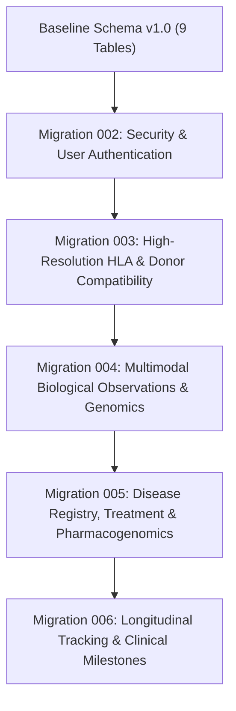

# MarrowQ Database Migration Plan & Schema Specification

**Date:** October 31, 2026  
**Scope:** Progressive Relational Schema Evolution (SQLite WAL for Local Development / PostgreSQL for Cloud Deployment)  
**Safety Protocol:** Zero-Downtime Migration; Additive-Only Changes; Non-Destructive to Existing Patients & Experiments  

---

## 1. Migration Strategy & Versioning

MarrowQ implements an internal schema version table (`schema_migrations`) that tracks all executed schema changes idempotently.



---

## 2. Target Schema Entity Catalog (22 Entities)

| Table Name | Primary Entity | Core Relationships | Purpose in Precision Medicine Architecture |
| :--- | :--- | :--- | :--- |
| `schema_migrations` | Schema Metadata | None | Tracks migration script execution and version stamps. |
| `users` | User Accounts | `role_permissions` | Secure user credentials (bcrypt hashed), MFA, active status. |
| `roles` & `permissions` | RBAC Access Control | `users` | Server-side role-based access control and privilege assignment. |
| `patients` | Master Patient Record | `encounters`, `observations` | Core demographic, transplant type, and clinical baseline data. |
| `encounters` | Clinical Encounters | `patients` | Outpatient visits, inpatient admissions, and conditioning phases. |
| `specimens` | Biological Samples | `encounters` | Blood, marrow aspirate, trephine core, saliva, peripheral blood DNA. |
| `multimodal_observations`| Clinical & Lab Data | `specimens`, `patients` | Quantitative and categorical measurements with LOINC/UCUM units. |
| `genomic_variants` | Molecular Alterations | `specimens`, `patients` | VCF somatic and germline variants with HGVS, VAF, and ClinVar IDs. |
| `hla_typings` | High-Res HLA Profiles | `patients`, `donors` | High-resolution 2-field alleles (A, B, C, DRB1, DQB1, DPB1). |
| `donor_registry` | Donor Candidates | `hla_typings` | Verified related, unrelated, and haploidentical donor profiles. |
| `donor_evaluations` | Compatibility Runs | `patients`, `donors` | Locus matching scores, DPB1 TCE permissiveness, DSA results. |
| `diagnoses` | Disease Classifications| `encounters`, `patients`| ICD-10, WHO 2022 classifications, ELN risk, clinician sign-off. |
| `treatment_plans` | Clinical Protocols | `diagnoses`, `patients` | Recommended regimens (e.g. 7+3, Ven+Aza, Cy/TBI conditioning). |
| `medication_orders` | Prescriptions | `patients` | Drug orders, dosage, administration frequency, review status. |
| `pharmacogenomic_alerts` | PGx Safety Warnings | `medication_orders` | CPIC Level A/B alerts generated for $TPMT, NUDT15, DPYD, etc.$ |
| `recovery_trajectories` | Longitudinal Recovery | `patients` | ASTCT milestone evaluations, observed vs forecasted ANC/platelets. |
| `model_registry` | Central Model Store | `predictions` | Serialized scikit-learn/Qiskit pipelines with validation metrics. |
| `prediction_runs` | Model Predictions | `patients`, `models` | Input snapshots, inference results, confidence intervals, provenance. |
| `quantum_jobs` | Quantum Execution Log | None | IBM Quantum QPU and Aer simulator circuit execution audit. |
| `datasets` | Research Cohorts | `experiments` | Cohort metadata, data mode, profile JSON, and leakage audits. |
| `experiments` | ML & Quantum Runs | `datasets` | Classical benchmark metrics, confusion matrices, runtime telemetry. |
| `audit_events` | Security Audit Trail | `users`, `patients` | Immutable event log for access, modifications, and CDSS reviews. |

---

## 3. Progressive SQL Migration DDL Scripts

### Migration 002: Security, Authentication & User Management
```sql
CREATE TABLE IF NOT EXISTS schema_migrations (
    version INTEGER PRIMARY KEY,
    name TEXT NOT NULL,
    applied_at TEXT NOT NULL
);

CREATE TABLE IF NOT EXISTS users (
    user_id TEXT PRIMARY KEY,
    username TEXT UNIQUE NOT NULL,
    email TEXT UNIQUE NOT NULL,
    password_hash TEXT NOT NULL,
    full_name TEXT NOT NULL,
    role TEXT NOT NULL CHECK(role IN ('clinician_doctor', 'clinical_researcher', 'patient_family', 'hospital_admin')),
    is_active INTEGER NOT NULL DEFAULT 1,
    created_at TEXT NOT NULL,
    last_login TEXT
);

CREATE TABLE IF NOT EXISTS user_sessions (
    session_id TEXT PRIMARY KEY,
    user_id TEXT NOT NULL REFERENCES users(user_id) ON DELETE CASCADE,
    refresh_token TEXT UNIQUE NOT NULL,
    expires_at TEXT NOT NULL,
    created_at TEXT NOT NULL
);
```

### Migration 003: High-Resolution HLA & Donor Compatibility
```sql
CREATE TABLE IF NOT EXISTS hla_typings (
    typing_id TEXT PRIMARY KEY,
    subject_type TEXT NOT NULL CHECK(subject_type IN ('recipient', 'donor')),
    subject_id TEXT NOT NULL,
    hla_a1 TEXT NOT NULL, hla_a2 TEXT NOT NULL,
    hla_b1 TEXT NOT NULL, hla_b2 TEXT NOT NULL,
    hla_c1 TEXT NOT NULL, hla_c2 TEXT NOT NULL,
    hla_drb1_1 TEXT NOT NULL, hla_drb1_2 TEXT NOT NULL,
    hla_dqb1_1 TEXT NOT NULL, hla_dqb1_2 TEXT NOT NULL,
    hla_dpb1_1 TEXT, hla_dpb1_2 TEXT,
    resolution_level TEXT NOT NULL DEFAULT 'high_resolution_2_field',
    verified_by TEXT,
    created_at TEXT NOT NULL
);

CREATE TABLE IF NOT EXISTS donor_candidates (
    donor_id TEXT PRIMARY KEY,
    registry_source TEXT NOT NULL,
    donor_type TEXT NOT NULL CHECK(donor_type IN ('matched_sibling', 'matched_unrelated', 'mismatched_unrelated', 'haploidentical', 'cord_blood')),
    age INTEGER NOT NULL,
    sex TEXT NOT NULL,
    abo_type TEXT NOT NULL,
    cmv_serostatus TEXT NOT NULL,
    availability_status TEXT NOT NULL DEFAULT 'available',
    created_at TEXT NOT NULL
);

CREATE TABLE IF NOT EXISTS donor_compatibility_evaluations (
    evaluation_id TEXT PRIMARY KEY,
    patient_id TEXT NOT NULL REFERENCES patients(patient_id),
    donor_id TEXT NOT NULL REFERENCES donor_candidates(donor_id),
    match_grade TEXT NOT NULL,
    match_score_10 REAL NOT NULL,
    match_score_12 REAL NOT NULL,
    dpb1_tce_permissiveness TEXT NOT NULL CHECK(dpb1_tce_permissiveness IN ('PERMISSIVE', 'NON_PERMISSIVE_GVH', 'NON_PERMISSIVE_HVG', 'FULL_MATCH')),
    dsa_status TEXT NOT NULL CHECK(dsa_status IN ('NEGATIVE', 'POSITIVE_LOW_MFI', 'POSITIVE_HIGH_MFI')),
    dsa_max_mfi REAL DEFAULT 0.0,
    abo_compatibility TEXT NOT NULL CHECK(abo_compatibility IN ('COMPATIBLE', 'MAJOR_MISMATCH', 'MINOR_MISMATCH', 'BIDIRECTIONAL_MISMATCH')),
    overall_recommendation TEXT NOT NULL,
    evaluated_at TEXT NOT NULL
);
```

### Migration 004: Multimodal Biological Observations & Genomics
```sql
CREATE TABLE IF NOT EXISTS specimens (
    specimen_id TEXT PRIMARY KEY,
    patient_id TEXT NOT NULL REFERENCES patients(patient_id),
    specimen_type TEXT NOT NULL,
    collection_date TEXT NOT NULL,
    collection_day_post_tx INTEGER,
    anatomical_site TEXT,
    created_at TEXT NOT NULL
);

CREATE TABLE IF NOT EXISTS multimodal_observations (
    observation_id TEXT PRIMARY KEY,
    patient_id TEXT NOT NULL REFERENCES patients(patient_id),
    specimen_id TEXT REFERENCES specimens(specimen_id),
    modality TEXT NOT NULL CHECK(modality IN ('haematology', 'biochemistry', 'bone_marrow', 'flow_cytometry', 'cytogenetics', 'imaging')),
    metric_name TEXT NOT NULL,
    loinc_code TEXT,
    numeric_value REAL,
    unit TEXT,
    categorical_value TEXT,
    payload_json TEXT,
    recorded_at TEXT NOT NULL,
    day_post_tx INTEGER NOT NULL,
    verification_status TEXT NOT NULL DEFAULT 'verified'
);

CREATE TABLE IF NOT EXISTS genomic_variants (
    variant_id TEXT PRIMARY KEY,
    patient_id TEXT NOT NULL REFERENCES patients(patient_id),
    gene_symbol TEXT NOT NULL,
    hgvs_c TEXT,
    hgvs_p TEXT,
    chromosome TEXT NOT NULL,
    genomic_position INTEGER NOT NULL,
    ref_allele TEXT NOT NULL,
    alt_allele TEXT NOT NULL,
    variant_allele_fraction REAL,
    read_depth INTEGER,
    clinical_significance TEXT,
    clinvar_id TEXT,
    detected_at TEXT NOT NULL
);
```

### Migration 005: Disease Registry, Treatment & Pharmacogenomics
```sql
CREATE TABLE IF NOT EXISTS clinical_diagnoses (
    diagnosis_id TEXT PRIMARY KEY,
    patient_id TEXT NOT NULL REFERENCES patients(patient_id),
    disease_code TEXT NOT NULL,
    disease_name TEXT NOT NULL,
    classification_system TEXT NOT NULL,
    risk_category TEXT,
    status TEXT NOT NULL CHECK(status IN ('SUSPECTED_DRAFT', 'CONFIRMED_BY_CLINICIAN', 'RULED_OUT')),
    supporting_evidence_json TEXT NOT NULL,
    diagnosed_by TEXT,
    diagnosed_at TEXT NOT NULL
);

CREATE TABLE IF NOT EXISTS pharmacogenomic_alerts (
    alert_id TEXT PRIMARY KEY,
    patient_id TEXT NOT NULL REFERENCES patients(patient_id),
    gene_symbol TEXT NOT NULL,
    diplotype TEXT NOT NULL,
    phenotype TEXT NOT NULL,
    medication_name TEXT NOT NULL,
    cpic_level TEXT NOT NULL,
    alert_severity TEXT NOT NULL CHECK(alert_severity IN ('CONTRAINDICATION', 'DOSE_REDUCTION', 'CAUTION', 'INFO')),
    clinical_recommendation TEXT NOT NULL,
    created_at TEXT NOT NULL
);
```
