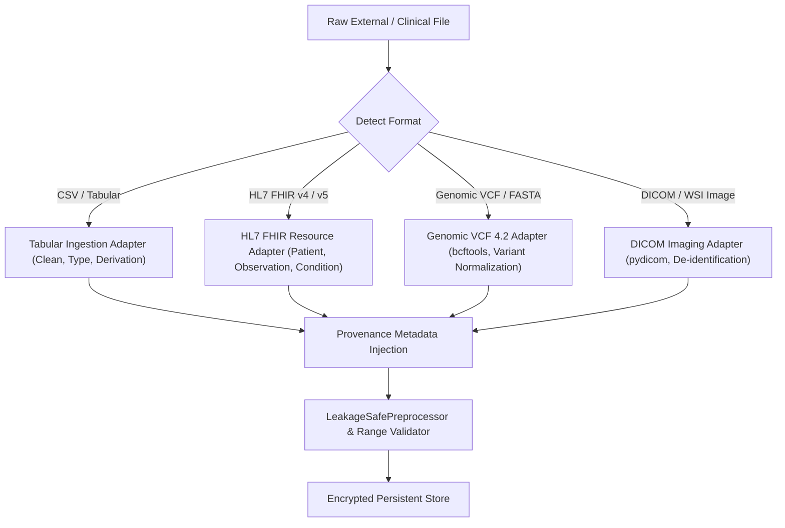

# MarrowQ Dataset Catalog & Data Governance Registry

**Date:** October 31, 2026  
**Scope:** Public, Managed-Access, and Synthetic Research Datasets for Precision Medicine, Leukaemia, and HSCT  
**Standard:** FAIR Data Principles (Findable, Accessible, Interoperable, Reusable)  

---

## 1. Verified Public & Managed-Access Datasets

| Dataset Identifier | Dataset Name & Origin | Exact Access URL / DOI | Access Type & License | Sample Size ($N$) | Biological Modalities & Features | Clinical Endpoints & Outcomes | Known Limitations & Missingness | Validation Role in MarrowQ |
| :--- | :--- | :--- | :--- | :--- | :--- | :--- | :--- | :--- |
| **`UCI-BMT-187`** | Paediatric Bone Marrow Transplant Cohort (Wroclaw Medical Univ.) | [UCI Machine Learning Repository](https://archive.ics.uci.edu/dataset/565/bone+marrow+transplant+children) | Open Public (CC-BY 4.0) | $N = 187$ paediatric recipients | 36 pre-transplant features: recipient/donor age, sex, body mass, disease type, risk status, ABO, CMV, HLA match, cell dose (CD34+, CD3+). | Time to neutrophil recovery, platelet recovery, acute/chronic GVHD, relapse, overall survival ($t$, event). | Small cohort size; single European clinical centre; missing detailed cytogenetic karyotypes and longitudinal lab draws. | Primary benchmark training and 5x5 nested cross-validation for HSCT models. |
| **`CIBMTR-PUB-2024`** | CIBMTR Research Database Publicly Released Outcomes | [CIBMTR Research Datasets](https://www.cibmtr.org/Studies/Public-Use-Data-Sets) | Open Research Access (CIBMTR DUA) | $N = 15,000+$ allogeneic HSCT | Comprehensive demographic, HLA high-resolution typing, conditioning regimen, HCT-CI comorbidities, donor relationship. | 100-day NRM, Grade II–IV aGVHD, cGVHD, 1-year and 5-year OS, progression-free survival. | Retrospective registry reporting; heterogeneity in conditioning protocols across decades; selective missingness in secondary biomarkers. | Large-scale external validation of prognostic survival and comorbidity risk scoring. |
| **`TCGA-LAML`** | The Cancer Genome Atlas: Acute Myeloid Leukemia Cohort | [GDC Data Portal (TCGA-LAML)](https://portal.gdc.cancer.gov/projects/TCGA-LAML) | Open Access (Genomic Data Commons) | $N = 200$ de novo AML patients | Whole-exome sequencing, RNA-seq, microRNA-seq, DNA methylation, cytogenetics, clinical morphology. | Overall survival, event-free survival, complete remission (CR) status, relapse. | Untreated adult cohort only; lack of post-transplant follow-up; targeted panels evolved since original publication. | Molecular subtyping, gene mutation co-occurrence networks, and ELN 2022 risk stratification. |
| **`TARGET-AML`** | Therapeutically Applicable Research To Generate Effective Treatments (AML) | [TARGET Data Matrix](https://ocg.cancer.gov/programs/target/data-matrix) | Open / Controlled Tier (dbGaP phs000465) | $N = 1,023$ paediatric AML cases | Whole-genome, whole-exome sequencing, RNA-seq, microRNA, DNA methylation, copy number variation. | Induction response, minimal residual disease (MRD), event-free survival, relapse, OS. | Controlled access required for raw BAM/FASTQ; paediatric-specific disease biology (high $KMT2A$ and $CBF$ frequency). | Paediatric AML diagnostic intelligence and molecular prognostic model training. |
| **`TARGET-ALL`** | TARGET Paediatric Acute Lymphoblastic Leukaemia Cohort | [TARGET Data Matrix (ALL)](https://ocg.cancer.gov/programs/target/data-matrix) | Open / Controlled Tier (dbGaP phs000218) | $N = 2,042$ paediatric B-ALL & T-ALL | High-throughput sequencing, target gene capture, cytogenetics ($ETV6::RUNX1, BCR::ABL1$, hyperdiploidy, Ph-like). | Minimal residual disease Day +29, 5-year EFS, central nervous system relapse. | Heterogeneous multi-trial consortium; extensive preprocessing required for uniform variant harmonization. | Paediatric ALL risk stratification and targeted therapy matching. |
| **`GEO-GSE37642`** | Gene Expression Omnibus: AML Prognostic Gene Signature | [NCBI GEO GSE37642](https://www.ncbi.nlm.nih.gov/geo/query/acc.cgi?acc=GSE37642) | Open Public (NCBI GEO) | $N = 562$ adult AML patients | Microarray mRNA expression profiles (Affymetrix HG-U133 Plus 2.0) of diagnostic bone marrow. | Complete remission, overall survival, karyotype categories. | Microarray platform; lacks full modern NGS panel mutations (e.g. $NPM1, CEBPA$ annotated, but others absent). | Gene expression prognostic index and transcriptomic feature extraction validation. |
| **`ClinVar-PGx`** | ClinVar & PharmGKB Genomic Variant Actionability Registry | [PharmGKB](https://www.pharmgkb.org/) / [ClinVar](https://www.ncbi.nlm.nih.gov/clinvar/) | Open Public (Creative Commons / ODC-By) | 5,000+ curated pharmacogenomic alleles | Star-allele definitions, diplotypes, functional activity scores for $TPMT, NUDT15, DPYD, CYP2C19, CYP2D6, CYP2C9$. | Prescribing guidelines, dose titration recommendations, toxicity phenotypes. | Static clinical rules; requires dynamic diplotype calling from raw patient VCF variant files. | Ground truth clinical rules for the Medication Suitability Engine. |
| **`HumanCellAtlas-BM`** | Human Cell Atlas: Immune and Haematopoietic Bone Marrow | [Human Cell Atlas Data Portal](https://data.humancellatlas.org/) | Open Public (CC-BY 4.0) | $N = 380,000+$ single cells (35 healthy donors) | Single-cell RNA-seq (10x Genomics), surface protein CITE-seq, spatial transcriptomics. | Healthy haematopoietic differentiation trajectories (HSC $\rightarrow$ CMP $\rightarrow$ GMP $\rightarrow$ Granulocyte). | Healthy reference data only; no longitudinal clinical transplant outcomes. | High-dimensional reference baseline for cellular differentiation and single-cell quantum state vector representations. |

---

## 2. Synthetic Grounded Cohorts (Demonstration Tier)

| Identifier | Name & Generator Algorithm | Storage Path | Row / Col Count | Permitted Usage | Transparency Protocol |
| :--- | :--- | :--- | :--- | :--- | :--- |
| **`SYNTH-HSCT-600`** | `generate_hsct_200plus_dataset` (CIBMTR-statistical copula) | `backend/app/data/cibmtr_hsct_200features.csv` | 600 rows $\times$ 210 columns | Algorithmic stress-testing, 156-qubit quantum transpilation benchmarks, integration tests. | Must always display the persistent banner: `"SYNTHETIC DEMONSTRATION DATA — NOT CLINICAL EVIDENCE. Zero fabricated patient claims."` |
| **`SYNTH-HSCT-50`** | `generate_hsct_synthetic_dataset` | `backend/app/data/cibmtr_hsct_50features.csv` | 300 rows $\times$ 50 columns | Rapid CI/CD testing, frontend rendering verification. | Explicitly flagged in database as `data_mode: "synthetic"`. |

---

## 3. Data Governance, Ingestion Adapters & Provenance Rules

### Ingestion Adapter Governance Rules
1. **Never use a single generic CSV parser for all data types.** Medical data formats have distinct schemas, coordinate systems, and quality checks.
2. **Preserve Immature Missingness:** Missing clinical variables must remain `None`/`null`. Zero-imputation or arbitrary default values (e.g. assuming normal platelet count) are strictly prohibited.
3. **Explicit Provenance Stamp:** Every ingested record must receive:
   - `dataset_id`
   - `source_uri`
   - `license_code`
   - `ingested_by`
   - `ingestion_timestamp_utc`
   - `data_mode`: `"clinical"` | `"cohort_example"` | `"synthetic"`
   - `anonymization_method`: `"safe_harbor"` | `"expert_determination"` | `"synthetic_simulation"`

