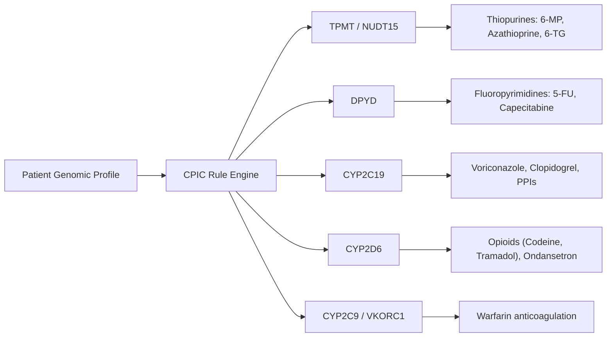

# MarrowQ Deep Scientific and Clinical Research

**Date:** October 31, 2026  
**Scope:** Literature, Guidelines, Biomarkers, Clinical Scoring Systems, and Pharmacogenomics for Haematology & Precision Medicine  
**Authoritative Sources:** CIBMTR, EBMT, ASTCT, NMDP, WHO, FDA, EMA, CPIC, PharmGKB, ClinVar, ClinGen, COSMIC, TCGA, GEO, cBioPortal, Human Cell Atlas, GTEx, ENCODE, PubMed, ClinicalTrials.gov, HL7 FHIR, GA4GH  

---

## 1. Clinical Guidelines & Consensus Definitions

### 1.1 ASTCT / EBMT / CIBMTR Engraftment & Chimerism Consensus Criteria

| Clinical Endpoint | Formal Consensus Definition | Clinical Significance & Laboratory Rules |
| :--- | :--- | :--- |
| **Neutrophil Engraftment** | The first of **three consecutive days** with Absolute Neutrophil Count (ANC) $\ge 0.5 \times 10^9/\text{L}$ ($500/\mu\text{L}$) following post-conditioning nadir. | Day 1 of the 3 consecutive days is designated the day of engraftment. Single isolated spikes (e.g. from G-CSF administration) without 3-day persistence do not qualify. |
| **Platelet Engraftment** | The first of **three consecutive days** with platelet count $\ge 20 \times 10^9/\text{L}$ ($20,000/\mu\text{L}$) without platelet transfusions for $\ge 7$ consecutive days. | Alternatively $\ge 50 \times 10^9/\text{L}$ for paediatric protocol definitions. Transfusion dependency must be explicitly ruled out. |
| **Primary Graft Failure** | Failure to achieve ANC $\ge 0.5 \times 10^9/\text{L}$ by Day +28 (or Day +42 for umbilical cord blood) with $< 5\%$ donor chimerism in the absence of disease relapse. | High non-relapse mortality; mandates immediate re-transplantation workup or autologous back-up infusion. |
| **Secondary Graft Failure** | Loss of donor haematopoiesis after initial documented engraftment (ANC dropping $< 0.5 \times 10^9/\text{L}$) not explained by relapse, drug toxicity, or viral infection. | Often accompanied by declining donor chimerism ($< 90\%$ or donor loss in CD3+/CD33+ lineages). |
| **Donor Chimerism** | Full donor chimerism: $\ge 95\%$ donor DNA in unfractionated peripheral blood or sorted CD3+ (T-cell) and CD33+ (myeloid) lineages via STR-PCR or NGS. | Mixed chimerism (5–94% donor) necessitates serial monitoring for immune relapse or graft rejection. |

---

### 1.2 Clinical Risk Stratification Systems

#### A. Haematopoietic Cell Transplantation-Specific Comorbidity Index (HCT-CI)
Developed by Sorror et al. (Blood 2005; JCO 2014). Outperforms Charlson Comorbidity Index for predicting non-relapse mortality (NRM):

$$\text{HCT-CI Score} = \sum_{k} w_k \cdot \mathbb{I}(\text{Comorbidity}_k)$$

* **Cardiovascular:** Arrhythmia (+1), Cardiac (coronary artery disease, congestive heart failure, LVEF $< 50\%$) (+3).
* **Pulmonary:** Moderate pulmonary (DLCO or FEV1 $66\text{--}80\%$) (+2); Severe pulmonary (DLCO or FEV1 $\le 65\%$, dyspnea at rest) (+3).
* **Hepatic:** Mild hepatic (bilirubin $>$ ULN or AST/ALT $> 1.5\times$ ULN) (+1); Moderate/severe hepatic (cirrhosis, bilirubin $> 2\times$ ULN, AST/ALT $> 2.5\times$ ULN) (+3).
* **Renal:** Serum creatinine $\ge 2.0\text{ mg/dL}$ or on dialysis (+2).
* **Infection:** Active systemic infection at conditioning (+1).
* **Prior Malignancy:** (+1).
* **Stratification:** Low Risk (0), Intermediate Risk (1–2), High Risk ($\ge 3$).

#### B. EBMT Risk Score for Allogeneic Transplantation
Predicts overall survival (OS) and leukaemia-free survival (LFS):
* **Recipient Age:** $< 20\text{ y}$ (0), $20\text{--}40\text{ y}$ (1), $> 40\text{ y}$ (2).
* **Disease Stage:** Early/CR1 (0), Intermediate/CR2 (1), Advanced/Relapsed (2).
* **Time from Diagnosis to Transplant:** $< 12\text{ months}$ (0), $> 12\text{ months}$ (1).
* **Donor Type:** HLA-identical sibling (0), Unrelated donor or mismatched related (1).
* **Donor-Recipient Sex Match:** Any match other than female donor to male recipient (0); Female donor to male recipient (1).
* **Total Score:** 0 to 7.

#### C. European LeukemiaNet (ELN) 2022 Risk Stratification for AML
Döhner et al. (Blood 2022;140(12):1345-1377):

| ELN 2022 Risk Category | Defining Cytogenetic and Molecular Abnormalities |
| :--- | :--- |
| **Favourable** | $t(8;21)(q22;q22.1)/RUNX1::RUNX1T1$; $inv(16)(p13.1q22)$ or $t(16;16)/CBFB::MYH11$; Mutated $NPM1$ without bZIP in-frame mutated $CEBPA$; Mutated $CEBPA$ (in-frame bZIP mutations, mono- or bi-allelic). |
| **Intermediate** | Mutated $NPM1$ with $FLT3\text{-ITD}$; Wild-type $NPM1$ with $FLT3\text{-ITD}$ (without adverse-risk cytogenetics); $t(9;11)(p21.3;q23.3)/MLLT3::KMT2A$; Cytogenetic abnormalities not classified as favourable or adverse. |
| **Adverse** | Complex karyotype ($\ge 3$ unrelated abnormalities); Monosomal karyotype; $inv(3)(q21.3q26.2)$ or $t(3;3)/GATA2::MECOM$; $t(6;9)(p23;q34.1)/DEK::NUP214$; $KMT2A$ rearrangements (other than $t(9;11)$); $MECOM$ rearrangements; $-5$ or $del(5q)$; $-7$; $-17/abn(17p)$; Mutated $TP53$ (VAF $\ge 10\%$); Myelodysplasia-related mutations: $ASXL1, BCOR, EZH2, RUNX1, SF3B1, SRSF2, STAG2, U2AF1, ZRSR2$. |

#### D. Molecular International Prognostic Scoring System for MDS (IPSS-M)
Bernard et al. (NEJM Evidence 2022):
Incorporates clinical variables (haemoglobin, platelets, bone marrow blasts) alongside cytogenetic risk categories and **31 mutated genes** categorized into main effect genes ($TP53^{\text{multihit}}, MLL^{\text{PTD}}, FLT3\text{-ITD/TKD}, SF3B1^{\text{5q}}, NPM1, RUNX1, NRAS, ETV6, CBL, U2AF1, SRSF2, DNMT3A, ASXL1, KRAS, IDH2, etc.$):
* Very Low ($\le -1.5$)
* Low ($> -1.5\text{ to } -0.5$)
* Moderate Low ($> -0.5\text{ to } 0$)
* Moderate High ($> 0\text{ to } 0.5$)
* High ($> 0.5\text{ to } 1.5$)
* Very High ($> 1.5$)

---

## 2. Pharmacogenomics & Medication Safety (CPIC / PharmGKB)

MarrowQ's Medication Suitability Engine evaluates Clinical Pharmacogenetics Implementation Consortium (CPIC) Level A/B guidelines:

### Detailed Gene-Drug Interaction Rules

| Gene | Diplotype / Allele Phenotype | Targeted Medication | CPIC Clinical Recommendation & Safety Action |
| :--- | :--- | :--- | :--- |
| **TPMT** | $*1/*2, *1/*3A, *1/*3C$ (Intermediate Metaboliser) | Mercaptopurine (6-MP), Azathioprine | Reduce starting dose by 30–70%; adjust based on myelosuppression and ANC monitoring. |
| **TPMT** | $*3A/*3A, *2/*3A$ (Poor Metaboliser) | Mercaptopurine, Azathioprine | Reduce dose by $90\%$ (e.g. give $10\%$ of normal dose, 3 times/week) or select non-thiopurine alternative. High fatal pancytopenia risk. |
| **NUDT15** | $*1/*3, *3/*3$ (Intermediate / Poor Metaboliser) | Mercaptopurine, Azathioprine | Critical in East Asian, South Asian, and Hispanic populations. Reduce dose by 50–90% to avoid catastrophic early leukopenia and alopecia. |
| **DPYD** | $*2A$ ($c.1905+1G>A$), $*13$ ($c.1679T>G$), $c.2846A>T$, HapB3 | 5-Fluorouracil (5-FU), Capecitabine | Poor/Intermediate metabolisers: severe risk of lethal neutropenia, mucositis, and neurotoxicity. Dose reduction by 50% or avoid. |
| **CYP2C19** | $*2/*2, *3/*3$ (Poor Metaboliser) | Voriconazole (First-line HSCT antifungal) | Substantially elevated voriconazole plasma concentrations; high risk of neurotoxicity/hepatotoxicity. Choose alternative agent (e.g. isavuconazole or liposomal amphotericin B). |
| **CYP2C19** | $*17/*17$ (Ultrarapid Metaboliser) | Voriconazole | Significantly decreased plasma trough concentrations ($< 1.0\text{ mg/L}$); risk of breakthrough invasive fungal infection (Aspergillus). Increase dose or switch. |
| **CYP2D6** | $*4/*4, *5/*5$ (Poor Metaboliser) | Codeine, Tramadol | Inability to bioactivate prodrug to active morphine/O-desmethyltramadol; analgesia failure. Use alternative non-CYP2D6 analgesic. |
| **CYP2D6** | Ultrarapid Metaboliser ($\ge 3$ active copies) | Codeine, Tramadol | Rapid bioactivation causing potentially fatal respiratory depression even at standard therapeutic doses. Avoid entirely. |
| **CYP2C9 / VKORC1** | $CYP2C9*2, *3$ / $VKORC1 -1639G>A$ | Warfarin | Decreased clearance and heightened vitamin K epoxide reductase sensitivity. Requires algorithm-guided dose reduction (50–75%) to prevent major haemorrhage. |

---

## 3. High-Resolution Donor Compatibility Science

### 3.1 HLA Nomenclature & Matching Hierarchy
Human Leukocyte Antigen (HLA) genes are located on chromosome 6p21.3. High-resolution matching requires 2-field DNA typing (e.g. `HLA-A*02:01`, not serological `A2`):

$$\text{Classical 12-Allele Matching} = \text{HLA-A, B, C, DRB1, DQB1, DPB1 (two alleles per locus)}$$

* **10/10 Match (Standard Unrelated Donor):** Matched at HLA-A, -B, -C, -DRB1, -DQB1 at the allele level (2-field).
* **12/12 Match:** Matched at all 5 classical loci plus **HLA-DPB1**.
* **DPB1 Permissiveness (T-Cell Epitope - TCE Algorithm):**
  - Discovered by Fleischhauer et al. (Lancet Oncol 2012).
  - Even in a 10/10 matched unrelated donor, DPB1 mismatch occurs in $\sim 80\%$ of cases.
  - Mismatches are classified into **Permissive** (conserved T-cell epitope function, safe to transplant) vs **Non-Permissive** (associated with significantly increased non-relapse mortality and severe Grade III–IV acute GVHD).
  - TCE Grouping: Group 1, Group 2, Group 3 alleles. Vector directionality (host-vs-graft rejection vs graft-vs-host toxicity).

### 3.2 Non-HLA Donor Selection Determinants
In order of empirical impact on transplant outcomes (NMDP/CIBMTR evidence guidelines):
1. **HLA Match Grade:** 10/10 $>$ 9/10 (1 mismatch) $>$ 8/10. Each single HLA mismatch decreases 5-year OS by $\sim 8\text{--}10\%$.
2. **Donor Age:** Younger donor age is the most powerful non-HLA determinant. Donors aged 18–30 produce significantly higher OS and lower NRM than donors aged $> 40$.
3. **Donor-Specific Antibodies (DSA):** Presence of anti-HLA antibodies in recipient serum against mismatched donor HLA alleles ($MFI > 2000$) causes hyperacute or acute graft failure. Pre-transplant desensitization or alternative donor selection is mandatory.
4. **CMV Serostatus:**
   - CMV-negative recipient $\rightarrow$ CMV-negative donor is optimal to avoid primary CMV infection.
   - CMV-positive recipient $\rightarrow$ CMV-positive donor provides protective adoptive memory T-cells, reducing CMV reactivation mortality.
5. **ABO Blood Group Compatibility:**
   - Major mismatch (e.g. Donor A $\rightarrow$ Recipient O): Risk of delayed red cell engraftment, pure red cell aplasia (PRCA), and acute haemolysis.
   - Minor mismatch (e.g. Donor O $\rightarrow$ Recipient A): Risk of passenger lymphocyte syndrome (PLS) with acute haemolysis on Day +7 to +14.
   - Bidirectional mismatch (e.g. Donor A $\rightarrow$ Recipient B).
6. **Sex Matching:** Female donor into male recipient (F $\rightarrow$ M) is associated with increased acute and chronic GVHD due to H-Y minor histocompatibility antigens.

---

## 4. Multimodal Biological Data Taxonomy

```mermaid
graph TD
    BioData["Multimodal Patient Biological Record"] --> Blood["A. Blood & Serum Biomarkers"]
    BioData --> Marrow["B. Bone Marrow Pathology"]
    BioData --> Genomics["C. Genomic & Molecular Omics"]
    BioData --> Imaging["D. Pathology & Imaging (DICOM/WSI)"]
    BioData --> Functional["E. Organ & Immune Functional Markers"]

    Blood --> B1["CBC with Differential"]
    Blood --> B2["Serum Chemistry & Electrolytes"]
    Blood --> B3["Inflammatory Cytokines: IL-6, Ferritin, CRP"]
    Blood --> B4["Flow Cytometry (T/B/NK cell panels)"]

    Marrow --> M1["Aspirate Differential & Morphology"]
    Marrow --> M2["Core Biopsy Cellularity & Fibrosis (MF-0 to MF-3)"]
    Marrow --> M3["Immunohistochemistry: CD34, CD117, MPO"]
    Marrow --> M4["Minimal Residual Disease (MRD: Flow vs NGS)"]

    Genomics --> G1["Karyotype & ISCN Cytogenetics"]
    Genomics --> G2["FISH Panels"]
    Genomics --> G3["Targeted Myeloid/Lymphoid NGS Panels (VCF)"]
    Genomics --> G4["RNA-seq Gene Fusion Profiles"]
    Genomics --> G5["Pharmacogenomic Variants (CPIC Level A/B)"]

    Imaging --> I1["Whole-Slide Histopathology Imaging"]
    Imaging --> I2["Computed Tomography (CT)"]
    Imaging --> I3["Magnetic Resonance Imaging (MRI)"]
    Imaging --> I4["18F-FDG PET/CT Metabolic Imaging"]

    Functional --> F1["Echocardiography (LVEF, Strain)"]
    Functional --> F2["Pulmonary Function (PFT: FEV1, DLCO)"]
    Functional --> F3["Renal Clearance (eGFR, Cystatin C)"]
    Functional --> F4["Hepatic Function (FibroScan, Bilirubin)"]
```

---

## 5. Clinical Decision-Support Boundaries

Under FDA CDSS Guidance (2022) and EU MDR Annex VIII (Rule 11):
1. **Non-Autonomous Role:** MarrowQ outputs are strictly **draft decision-support syntheses**. The software does not diagnose, prescribe, titrate medication, or authorise transplantation.
2. **Transparent Basis for Recommendations:** Every recommendation must expose the underlying evidence factor, registry reference, and confidence interval.
3. **Mandatory Clinician Verification:** All model suggestions remain in `PENDING_REVIEW` until an authorised physician reviews and signs off on the record.

