# MarrowQ Disease Module Specifications

**Date:** October 31, 2026  
**Scope:** Priority Haematological Malignancies, Bone Marrow Failure Syndromes, and Future Multi-Specialty Expansion  
**Diagnostic Standards:** WHO Classification of Haematolymphoid Tumours (5th Edition, 2022); International Consensus Classification (ICC 2022); ELN 2022; IPSS-M  

---

## 1. Priority Disease Module Specifications

```mermaid
graph TD
    DiseaseRegistry["MarrowQ Disease Intelligence Registry"] --> Myeloid["Myeloid Malignancies"]
    DiseaseRegistry --> Lymphoid["Lymphoid Malignancies"]
    DiseaseRegistry --> Failure["Bone Marrow Failure"]
    DiseaseRegistry --> Transplant["Transplant Complications"]
    DiseaseRegistry --> Future["Future Specialty Modules"]

    Myeloid --> D1["1. Acute Myeloid Leukaemia (AML)"]
    Myeloid --> D2["2. Myelodysplastic Syndromes (MDS)"]
    Myeloid --> D3["3. Chronic Myeloid Leukaemia (CML)"]
    Myeloid --> D4["4. Myeloproliferative Neoplasms (MPN)"]

    Lymphoid --> D5["5. Acute Lymphoblastic Leukaemia (ALL)"]
    Lymphoid --> D6["6. Chronic Lymphocytic Leukaemia (CLL)"]
    Lymphoid --> D7["7. Multiple Myeloma (MM)"]
    Lymphoid --> D8["8. Malignant Lymphoma (HL / NHL)"]

    Failure --> D9["9. Severe Aplastic Anaemia (SAA)"]
    Transplant --> D10["10. Post-HSCT Complications (GVHD, SOS/VOD, TMA, CMV)"]

    Future --> F1["Solid Oncology (Breast, Lung, Colorectal)"]
    Future --> F2["Nephrology (CKD, AKI)"]
    Future --> F3["Hepatology (Fibrosis, Cirrhosis)"]
    Future --> F4["Cardiology (Cardiotoxicity, Heart Failure)"]
```



---

### Module 1: Acute Myeloid Leukaemia (AML)
* **Disease Code:** `DIS-HEM-AML`
* **Diagnostic Definition:** Clonal haematopoietic stem/progenitor cell malignancy with bone marrow or peripheral blood blasts $\ge 20\%$, OR presence of defining recurring genetic abnormalities irrespective of blast percentage ($t(8;21), inv(16), t(15;17)/PML::RARA$).
* **Required Biological Data:**
  - CBC with manual blood smear differential (Auer rods, promyelocytes).
  - Bone marrow aspirate differential & trephine core biopsy.
  - Flow cytometry: CD34, CD117, CD33, CD13, HLA-DR, CD14, CD64, MPO.
  - Conventional cytogenetic karyotyping (ISCN 2020) & FISH panel.
  - Targeted myeloid NGS (54-gene panel: $NPM1, FLT3, CEBPA, TP53, IDH1, IDH2, DNMT3A, RUNX1, ASXL1$).
* **Risk Stratification Model:** European LeukemiaNet (ELN) 2022 (Favourable, Intermediate, Adverse).
* **Treatment Options Evaluated:**
  - Intensive Induction: $7+3$ (Cytarabine + Daunorubicin); CPX-351 (liposomal cytarabine/daunorubicin for secondary/MRC AML).
  - Targeted Therapies: Midostaurin / Gilteritinib ($FLT3$ mutated); Ivosidenib ($IDH1$ mutated); Enasidenib ($IDH2$ mutated); Gemtuzumab ozogamicin (CD33+ favourable/intermediate).
  - Non-Intensive Regimens: Venetoclax + Azacitidine (HMA + BCL-2 inhibitor).
  - Consolidation & Allogeneic HSCT: Indications determined by ELN 2022 risk and post-remission MRD status.

---

### Module 2: Myelodysplastic Syndromes (MDS)
* **Disease Code:** `DIS-HEM-MDS`
* **Diagnostic Definition:** Clonal stem cell disorder characterized by ineffective haematopoiesis, peripheral cytopenias (anaemia, neutropenia, thrombocytopenia), morphological dysplasia in $\ge 10\%$ of one or more lineages, and risk of AML transformation.
* **Required Biological Data:**
  - CBC, reticulocyte count, iron studies (ferritin, transferrin saturation), EPO level.
  - Bone marrow aspirate and biopsy with Prussian blue iron stain (ring sideroblasts) and reticulin fibrosis stain.
  - Karyotype (del(5q), -7/del(7q), +8, complex).
  - Molecular NGS panel: $SF3B1, TET2, ASXL1, SRSF2, U2AF1, TP53, RUNX1$.
* **Risk Stratification Model:** Molecular International Prognostic Scoring System (**IPSS-M**, Bernard et al., NEJM Evid 2022) and IPSS-R.
* **Treatment Options Evaluated:**
  - Lower-Risk MDS: Luspatercept (for ring sideroblasts / $SF3B1$ mutation); ESAs (for EPO $< 500\text{ U/L}$); Lenalidomide (for isolated del(5q)).
  - Higher-Risk MDS: Hypomethylating agents (Azacitidine, Decitabine); Early allogeneic HSCT consultation.

---

### Module 3: Severe Aplastic Anaemia (SAA)
* **Disease Code:** `DIS-HEM-SAA`
* **Diagnostic Definition (Camitta Criteria):**
  - Bone marrow biopsy cellularity $< 25\%$ (or $< 50\%$ with $< 30\%$ haematopoietic cells).
  - At least two of the following peripheral blood cytopenias:
    1. Absolute Neutrophil Count (ANC) $< 0.5 \times 10^9/\text{L}$ ($< 500/\mu\text{L}$).
    2. Platelet count $< 20 \times 10^9/\text{L}$ ($< 20,000/\mu\text{L}$).
    3. Reticulocyte count $< 20 \times 10^9/\text{L}$ (or $< 1.0\%$).
  - *Very Severe Aplastic Anaemia (vSAA):* SAA criteria met with ANC $< 0.2 \times 10^9/\text{L}$ ($< 200/\mu\text{L}$).
* **Required Biological Data:**
  - Bone marrow trephine core biopsy (rule out hypoplastic MDS, hairy cell leukaemia).
  - PNH clone screening via high-sensitivity flow cytometry (CD55, CD59, FLAER on granulocytes and monocytes).
  - Cytogenetics to exclude abnormal clones.
  - Telomere length flow-FISH & germline testing ($TERT, TERC$) for inherited marrow failure.
* **Treatment Options Evaluated:**
  - Young patients ($< 40\text{ y}$) or fit older patients with matched sibling donor (MSD): **First-line Allogeneic HSCT**.
  - Patients lacking MSD: **Triple Immunosuppressive Therapy (IST)**: Horse Antithymocyte Globulin (h-ATG) + Cyclosporine A (CsA) + Eltrombopag (thrombopoietin receptor agonist).

---

### Module 4: Post-HSCT Complications
* **Disease Code:** `DIS-HEM-HSCT-COMP`
* **Sub-entities Evaluated:**
  1. **Acute Graft-versus-Host Disease (aGVHD):**
     - MAGIC Consensus Criteria (Mount Sinai Acute GVHD International Consortium).
     - Organ staging: Skin (rash BSA %), Gastrointestinal (diarrhoea stool volume mL/day), Liver (total bilirubin mg/dL).
     - Global severity: Grade I (mild) to Grade IV (life-threatening).
     - First-line: High-dose corticosteroids (Methylprednisolone $2\text{ mg/kg/day}$).
     - Steroid-refractory aGVHD: Ruxolitinib (JAK1/2 inhibitor).
  2. **Sinusoidal Obstruction Syndrome / Veno-Occlusive Disease (SOS/VOD):**
     - EBMT Diagnostic Criteria: Unexplained hyperbilirubinemia, painful hepatomegaly, rapid ascites/weight gain $> 5\%$.
     - Therapy: Defibrotide ($6.25\text{ mg/kg}$ IV every 6 hours).
  3. **Transplant-Associated Thrombotic Microangiopathy (TA-TMA):**
     - Criteria: De novo thrombocytopenia, microangiopathic haemolytic anaemia (schistocytes on blood smear), elevated LDH, decreased haptoglobin, proteinuria, hypertension.
     - Therapy: C5 complement inhibitor (Eculizumab / Ravulizumab) or withdrawal of calcineurin inhibitor.
  4. **CMV Reactivation:**
     - Quantitative CMV DNA viral load monitoring via real-time PCR.
     - Pre-emptive therapy threshold ($> 1,000\text{ IU/mL}$): Ganciclovir / Valganciclovir or Foscarnet; Maribavir for refractory CMV.

---

## 2. Future Specialty Expansion Architecture

All future modules extend the same abstract interface:

```python
class BaseDiseaseModule(ABC):
    @property
    @abstractmethod
    def disease_id(self) -> str: pass

    @abstractmethod
    def validate_biological_inputs(self, observations: Dict[str, Any]) -> ValidationResult: pass

    @abstractmethod
    def evaluate_diagnostic_criteria(self, observations: Dict[str, Any]) -> DiagnosticSynthesis: pass

    @abstractmethod
    def compute_prognostic_risk(self, observations: Dict[str, Any]) -> PrognosticScore: pass

    @abstractmethod
    def compare_treatment_options(self, patient_profile: Dict[str, Any]) -> List[TreatmentOption]: pass
```

* **Solid Oncology (Breast, Lung, Colorectal):** Integrates TNM 8th staging, ER/PR/HER2 and PD-L1 IHC, and somatic alterations ($EGFR, ALK, KRAS, BRAF$).
* **Nephrology (CKD & AKI):** KDIGO 2024 guidelines, eGFR trajectory modelling (CKD-EPI 2021), proteinuria (UACR), and renal replacement therapy timing.
* **Hepatology (Fibrosis & Cirrhosis):** MELD-Na score, Child-Pugh class, transient elastography (FibroScan kPa), and hepatocellular carcinoma surveillance.
* **Cardiology:** ACC/AHA cardiovascular risk, anthracycline cardiotoxicity monitoring via global longitudinal strain (GLS), and heart failure biomarker tracking (NT-proBNP).

