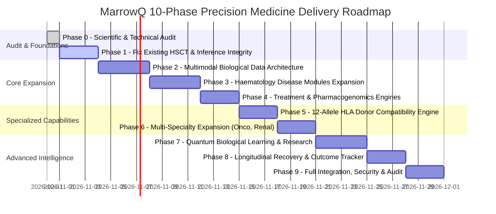

# MarrowQ Implementation Roadmap (Phases 0 through 9)

**Date:** October 31, 2026  
**Scope:** Engineering Execution Plan from Current Research Prototype to Production Precision Medicine Platform  
**Delivery Model:** Progressive, Phased, Test-Driven Evolution with Non-Breaking Migrations  

---

## 1. Phased Execution Overview

---

## 2. Detailed Phase Specifications & Acceptance Gates

### Phase 0: Full Technical & Scientific Audit (Current Phase)
* **Objective:** Comprehensive source-code audit, scientific literature review, clinical guideline mapping, and architecture planning.
* **Deliverables:** All 14 foundational specification and research documents.
* **Acceptance Gate:** 100% completion of audit findings and documentation; full team alignment on architecture.

---

### Phase 1: Fix Existing HSCT Correctness, Model Inference, Recovery & Security
* **Objective:** Remediate Known Issues A through L in the existing code before building new layers.
* **Action Items:**
  1. Replace hardcoded formulas in `ClassicalMLPredictionService` with a real model artifact loader that pulls from trained scikit-learn pipelines on the UCI cohort.
  2. Re-label `QuantumMLPredictionService` as an experimental fidelity reference probe; remove it from equal-weight diagnostic voting in `IndependentPredictionValidationAgent`.
  3. Fix the engraftment milestone bug in `backend/app/core/trajectory.py`: enforce 3 consecutive daily counts $\ge 500/\mu\text{L}$ for ANC; 3 counts $\ge 20,000/\mu\text{L}$ without transfusion for platelets.
  4. Enforce Zero-Imputation policy in `ClinicalDataQualityAgent`: missing mandatory labs must halt review with an explicit error rather than silently defaulting to 250 or 35,000.
  5. Add persistent clinical disclaimer badges on 3D Organ Viewer (`OrganViewer3D.tsx`) to avoid confusion with patient-specific scans.
  6. Implement server-side JWT authentication and RBAC endpoints (`/api/v2/auth`).
* **Verification:** All 42+ backend tests pass; new regression tests confirm consecutive engraftment criteria and real model predictions.

---

### Phase 2: Multimodal Biological Data Infrastructure & Ingestion Adapters
* **Objective:** Build ingestion adapters and database tables for Blood, Bone Marrow, Genomics (VCF), and Imaging.
* **Action Items:**
  1. Execute Database Migration 004 (`specimens`, `multimodal_observations`, `genomic_variants`).
  2. Implement `BloodObservationAdapter` with LOINC verification.
  3. Implement `BoneMarrowSynopticAdapter` (blasts, cellularity, fibrosis MF-0 to MF-3).
  4. Implement `GenomicVariantAdapter` with VCF 4.2 parser and ClinVar/PharmGKB annotations.
  5. Build the frontend **Biological Data View** displaying patient multi-omics profiles.
* **Verification:** Ingestion integration tests for CBC, bone marrow pathology, and genomic VCF files.

---

### Phase 3: Haematology Disease Expansion (AML, ALL, MDS, Aplastic Anaemia)
* **Objective:** Implement modular disease intelligence modules with WHO/ICC 2022 diagnostic criteria and ELN/IPSS-M risk scoring.
* **Action Items:**
  1. Implement `BaseDiseaseModule` and register `AMLModule`, `ALLModule`, `MDSModule`, and `AplasticAnaemiaModule`.
  2. Build differential diagnostic assessment pipeline in `DiagnosticAssessmentEngine`.
  3. Build frontend **Disease Assessment View** with differential diagnosis breakdown and missing investigation prompts.
* **Verification:** Disease classification tests against simulated clinical vignettes (e.g. AML with $NPM1$ mutation; MDS with del(5q)).

---

### Phase 4: Personalised Treatment Intelligence & Pharmacogenomics
* **Objective:** Deliver clinical trial matching, treatment comparison, and CPIC Level A/B pharmacogenomic safety alerts.
* **Action Items:**
  1. Implement `PharmacogenomicsEngine` with CPIC rules for $TPMT, NUDT15, DPYD, CYP2C19, CYP2D6, CYP2C9$.
  2. Implement `TreatmentComparisonEngine` mapping clinical indications to evidence regimens.
  3. Build frontend **Medication Suitability View** and **Treatment Intelligence View**.
* **Verification:** Test cases verifying drug-gene interaction triggers (e.g. voriconazole in $CYP2C19*2/*2$; 6-MP in $TPMT*3A/*3A$).

---

### Phase 5: High-Resolution HLA Donor Compatibility Engine
* **Objective:** Build real 12-allele HLA matching, DPB1 TCE permissiveness, DSA screening, and candidate donor ranking.
* **Action Items:**
  1. Execute Database Migration 003 (`hla_typings`, `donor_candidates`, `donor_evaluations`).
  2. Implement `DonorCompatibilityEngine` evaluating Class I (A, B, C) and Class II (DRB1, DQB1, DPB1).
  3. Integrate Fleischhauer T-Cell Epitope (TCE) permissiveness classification algorithm.
  4. Build frontend **Donor Compatibility View** with locus-by-locus breakdown and candidate ranking.
* **Verification:** Test cases for 10/10 vs 9/10 matching, DPB1 non-permissive mismatch detection, and DSA MFI threshold alerts.

---

### Phase 6: Multi-Specialty Expansion Architecture
* **Objective:** Activate interfaces for solid oncology, nephrology, hepatology, and cardiology.
* **Action Items:**
  1. Implement plug-and-play disease modules for Breast/Lung Cancer, CKD/AKI, Cirrhosis, and Cardiotoxicity.
  2. Update frontend navigation to support multi-specialty triage.
* **Verification:** Unit tests verifying external disease module registration without core system modifications.

---

### Phase 7: Multimodal Biological & Quantum Research Studio
* **Objective:** Advanced quantum kernel research, barren plateau diagnostics, and error-mitigated Heron QPU execution.
* **Action Items:**
  1. Expand quantum feature maps to include multi-qubit Pauli twirling and dynamical decoupling sequences.
  2. Implement real-time barren plateau variance calculation in the Quantum Lab.
  3. Connect QPU budget calculator to hardware submission workflow.
* **Verification:** Quantum test suite verifying statevector simulation fidelity, noise model accuracy, and error mitigation passes.

---

### Phase 8: Longitudinal Patient Recovery & Outcome Tracking
* **Objective:** Complete pre-, during-, and post-transplant longitudinal intelligence.
* **Action Items:**
  1. Build multi-timepoint trajectory visualization comparing actual lab observations with forecasted confidence intervals.
  2. Implement tracking for GVHD kinetics, chimerism dynamics, and infection surveillance.
  3. Implement prediction-versus-actual calibration tracking in database.
* **Verification:** Longitudinal trajectory tests with multi-week simulated patient recovery data.

---

### Phase 9: Full System Integration, Security, Audit & Final Validation
* **Objective:** End-to-end integration, performance optimization, security auditing, and documentation wrap-up.
* **Action Items:**
  1. Full penetration testing and DPDPA/HIPAA privacy compliance review.
  2. End-to-end user journey tests across Doctor, Researcher, Patient, and Hospital Admin workflows.
  3. Comprehensive test suite execution (backend pytest, API tests, Vite frontend build, linting).
* **Verification:** Zero test failures, zero TypeScript compilation errors, clean audit log generation.

