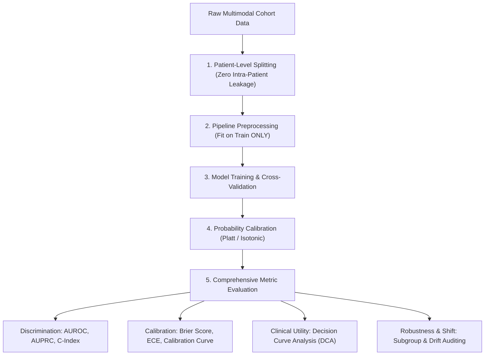

# MarrowQ Model Validation & Governance Plan

**Date:** October 31, 2026  
**Scope:** Machine Learning, Survival Analysis, and Quantum Kernel Model Governance  
**Standards:** TRIPOD-AI (Transparent Reporting of a Multivariable Prediction Model for Individual Prognosis or Diagnosis — AI); DECIDE-AI; FDA Good Machine Learning Practice (GMLP)  

---

## 1. Core Model Governance Principles

To ensure scientific validity and patient safety, all predictive and prognostic models in MarrowQ adhere to five non-negotiable validation mandates:



---

## 2. Validation Metrics & Thresholds

| Task Family | Primary Metric | Secondary Metric | Calibration & Reliability Metric | Minimum Acceptance Criteria |
| :--- | :--- | :--- | :--- | :--- |
| **Binary Classification** (e.g. Early Engraftment, Relapse at 1 yr) | Area Under the ROC Curve (**AUROC**) | Area Under Precision-Recall Curve (**AUPRC**) & Balanced Accuracy | **Brier Score** ($< 0.15$) & Expected Calibration Error (**ECE**) | $\text{AUROC} \ge 0.75$, $\text{Brier} \le 0.18$, 95% Bootstrap CI excludes 0.50. |
| **Time-to-Event / Survival** (Overall Survival, GVHD-free EFS) | Harrell's Concordance Index (**C-Index**) | Time-Dependent Cumulative Dynamic AUC ($t=1\text{ yr}, 2\text{ yr}$) | Integrated Brier Score (**IBS**) across horizons | $\text{C-Index} \ge 0.70$, $\text{IBS} \le 0.20$ across 3-year horizon. |
| **Continuous Recovery Forecasting** (Daily ANC / Platelets) | Mean Absolute Error (**MAE**) | Root Mean Squared Error (**RMSE**) | Prediction Interval Coverage Probability (**PICP** 95%) | $\text{PICP} \ge 90\%$, MAE within $\pm 150/\mu\text{L}$ for ANC. |
| **Quantum Kernel Classifiers** (QSVM vs Matched RBF) | Out-of-Fold AUROC (5x5 Nested CV) | Geometric Difference vs RBF ($g_{\text{diff}}$) | Off-Diagonal Kernel Matrix Variance ($\text{Var}[K_{i \ne j}]$) | Quantum model must demonstrate statistical equivalence or superiority; $\text{Var}[K] \gg O(2^{-n})$ to rule out Barren Plateaus. |

---

## 3. Zero Target Leakage Protocol

Target leakage occurs when features containing direct or proxy knowledge of the target outcome are included during training.
* **Leakage Sentinel Check:** In `LeakageSafePreprocessor`, all features are scanned against outcome proxies:
  - When target is `neutrophil_recovery_day28`, features such as `anc_recovery_day`, `post_tx_chimerism_day30`, `day_to_acute_gvhd`, and `discharge_day` are automatically identified and purged from the candidate feature set.
  - Mutual information ($I(X; Y)$) and Pearson correlation ($|r| > 0.92$) trigger automatic quarantine.

---

## 4. Model Registry & Metadata Specification

Every deployed model artifact must be registered in the `model_registry` table with immutable metadata:
```json
{
  "model_id": "MOD-QSVM-UCI-202610",
  "model_type": "QuantumKernelClassifier_ZZFeatureMap",
  "feature_schema": "v2.1_cibmtr_hsct",
  "selected_features": ["recipient_age", "cd34_dose", "hla_match", "stem_cell_source"],
  "dataset_provenance": {
    "dataset_id": "UCI-BMT-187",
    "sha256": "e3b0c44298fc1c149afbf4c8996fb92427ae41e4649b934ca495991b7852b855",
    "patient_count": 187
  },
  "metrics": {
    "cv_splits": 5,
    "cv_repeats": 5,
    "mean_auroc": 0.812,
    "auroc_95_ci": [0.742, 0.871],
    "brier_score": 0.141,
    "balanced_accuracy": 0.768
  },
  "hardware_requirements": {
    "simulator": "aer_simulator_statevector",
    "hardware_backend": "ibm_fez",
    "qubit_width": 4,
    "circuit_depth": 18
  },
  "validation_status": "VALIDATED_RESEARCH_TIER",
  "clinical_clearance": "RESTRICTED_DECISION_SUPPORT_ONLY"
}
```
