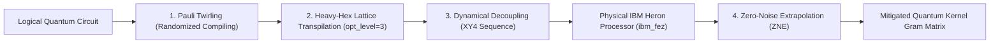

# MarrowQ Quantum Computing Research Roadmap

**Date:** October 31, 2026  
**Scope:** Quantum Machine Learning (QML), Quantum Kernel Methods, and IBM Quantum QPU Execution  
**Quantum Frameworks:** Qiskit 2.5+, Qiskit Aer 0.18+, Qiskit IBM Runtime Service (SamplerV2, EstimatorV2)  
**Target Hardware:** IBM Quantum Heron Processor (156 Qubits, heavy-hex lattice, tunable couplers, e.g. `ibm_fez`, `ibm_torino`)  

---

## 1. Mathematical Formulation: Quantum Kernel Learning

In quantum kernel methods (Havlicek et al., Nature 2019; Huang et al., Science 2021), classical biological feature vectors $x \in \mathbb{R}^d$ are mapped non-linearly into a quantum Hilbert state space $\mathcal{H}$ of dimension $2^n$ ($n$ qubits) via a parameterized quantum circuit (unitary feature map $U_\Phi(x)$):

$$\Phi: x \mapsto |\Phi(x)\rangle = U_\Phi(x) |0\rangle^{\otimes n}$$

The quantum kernel computes the transition amplitude (fidelity) between quantum states:

$$K(x, x') = |\langle \Phi(x) | \Phi(x') \rangle|^2 = \text{Tr}\left( \rho(x) \rho(x') \right) = \left| \langle 0|^{\otimes n} U_\Phi^\dagger(x') U_\Phi(x) |0\rangle^{\otimes n} \right|^2$$

This inner product is evaluated directly on quantum hardware using swap-test circuits or inversion circuits followed by all-zero projective measurement:

$$P(|0\dots0\rangle) = K(x, x')$$

The resulting $N \times N$ symmetric positive semi-definite Gram matrix $\mathbf{K}$ is fed into a dual Support Vector Machine:

$$\max_{\alpha} \sum_{i=1}^N \alpha_i - \frac{1}{2} \sum_{i,j=1}^N \alpha_i \alpha_j y_i y_j K(x_i, x_j) \quad \text{s.t.} \quad 0 \le \alpha_i \le C, \quad \sum_{i=1}^N \alpha_i y_i = 0$$

---

## 2. Barren Plateaus & Quantum Feature Map Design

### 2.1 The Phenomenon of Exponential Concentration
In quantum Hilbert spaces of high dimension ($2^n$), random or overly entangling feature maps suffer from **exponential concentration of measure** (Barren Plateaus in kernels, McClean et al., Nat Commun 2018; Thanasilp et al., Quantum 2022). As $n$ increases:

$$\text{Var}_{x, x'}[K(x, x')] \in O\left( \frac{1}{2^n} \right)$$

When this occurs, all off-diagonal kernel matrix elements converge to the exact same infinitesimal value, causing the QSVM to lose all discriminant capacity and collapse to a trivial random guesser.

### 2.2 MarrowQ Diagnostic Protocol: Monitoring Kernel Variance
For every qubit width sweep ($n \in \{2, 4, 8, 12, 16\}$), MarrowQ monitors:
1. **Off-Diagonal Variance:**
   $$\text{Var}_{\text{off}}[K] = \frac{1}{N(N-1)} \sum_{i \ne j} (K_{ij} - \bar{K}_{\text{off}})^2$$
   If $\text{Var}_{\text{off}}[K] < 10^{-4}$, the sweep logs a **Concentration Warning** (Barren Plateau state).
2. **Kernel-Target Alignment (KTA):**
   $$\text{KTA}(K, y) = \frac{y^T K y}{\|K\|_F \|y y^T\|_F} = \frac{\sum_{i,j} y_i y_j K_{ij}}{\sqrt{\sum_{i,j} K_{ij}^2} \cdot N}$$
3. **Geometric Difference ($g_{\text{diff}}$):**
   Quantifies the capacity of the quantum feature space to capture correlations missed by classical kernels (Huang et al., Nature Communications 2021).

---

## 3. Hardware Error Mitigation on IBM Heron QPU

To execute genuine circuits on physical IBM Quantum hardware without noise dominance, MarrowQ employs three complementary mitigation techniques:

1. **Pauli Twirling:** Converts coherent crosstalk and calibration drift across superconducting transmon qubits into stochastic, uncorrelated Pauli channels.
2. **Dynamical Decoupling (XY4):** Intersperses periodic microwave $\pi$-pulses ($X\text{-}Y\text{-}X\text{-}Y$) on idle spectator qubits during multi-qubit entangling gates, refocusing environmental magnetic and charge noise.
3. **Zero-Noise Extrapolation (ZNE):** Scales circuit noise intentionally (via digital pulse stretching or unitary folding $U \rightarrow U U^\dagger U$) and extrapolates the expectation value to the zero-noise limit ($\lambda \rightarrow 0$).

---

## 4. Quantum vs Classical Comparative Integrity

* **Zero Synthetic Parity:** The quantum model must **never** be artificially elevated or assigned equal diagnostic weight if a classical model (e.g. Gradient Boosting or RBF SVM) outperforms it.
* **Rigorous Nested Cross-Validation:** All quantum-classical comparisons must use 5-fold cross-validation with out-of-fold testing.
* **Transparent Execution Provenance:** Every result must report whether it was evaluated on:
  - `aer_simulator_statevector` (Exact numerical simulation)
  - `heron_noisy_simulation` (Thermal relaxation + readout error model)
  - `ibm_fez` (Genuine physical superconducting transmon QPU)
