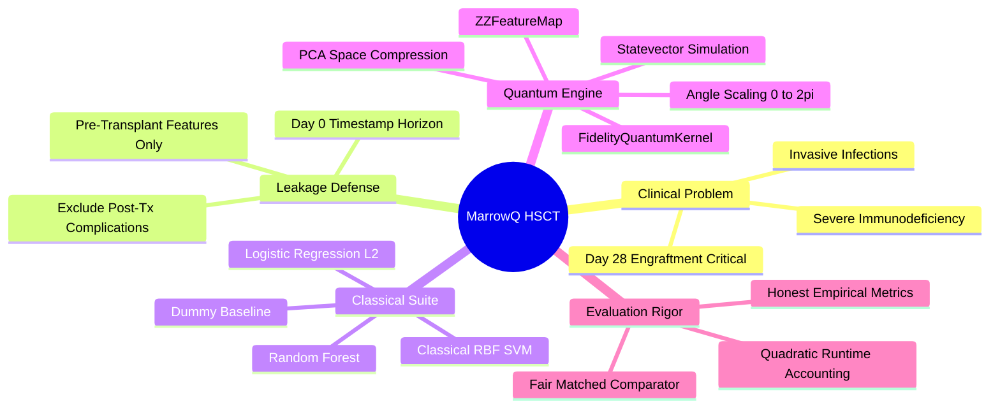
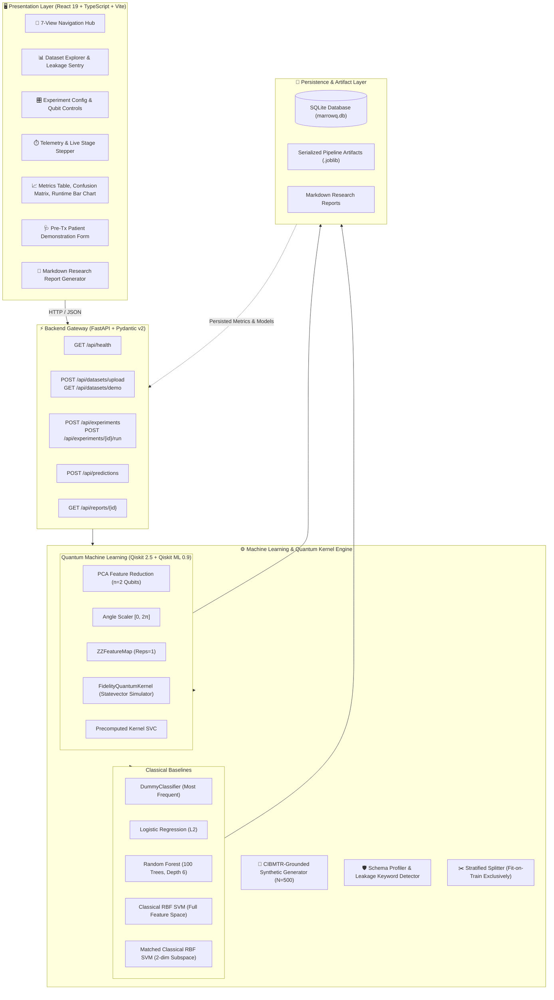
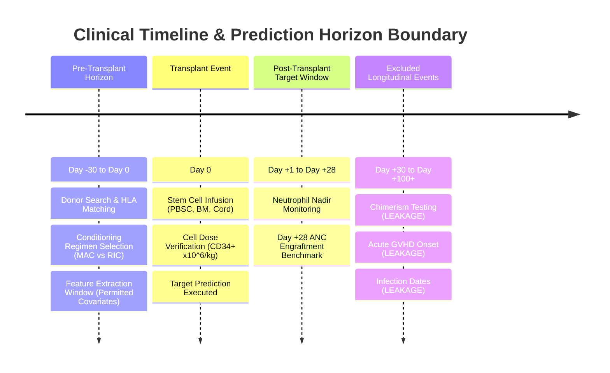
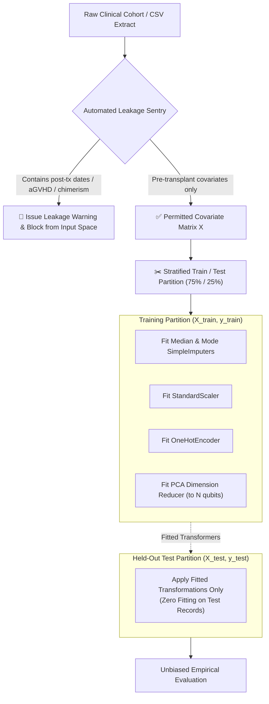
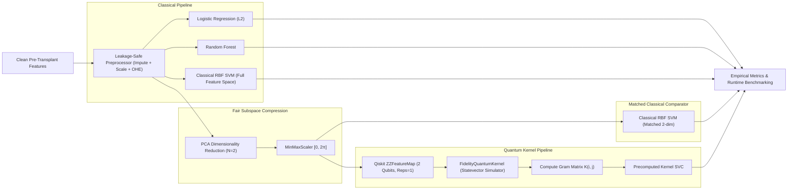
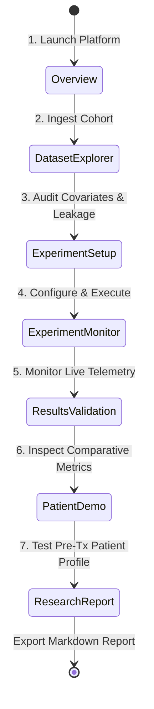

# MarrowQ — Quantum-Assisted HSCT Recovery Prediction

<div align="center">

```
  __  __                                  ____  
 |  \/  | __ _ _ __ _ __ _____      __   / __ \ 
 | |\/| |/ _` | '__| '__/ _ \ \ /\ / /  / / _` |
 | |  | | (_| | |  | | | (_) \ V  V /  | | (_| |
 |_|  |_|\__,_|_|  |_|  \___/ \_/\_/    \ \__,_|
                                         \____/ 
```

**Research-Grounded Clinical Machine Learning & Quantum Computing Platform**  
*Evaluating Quantum-Kernel Support Vector Machines against Classical Baselines for Hematopoietic Stem Cell Transplant Recovery*

[](https://marrowq.vercel.app)
[]()
[]()
[]()
[]()
[]()
[]()

**🌐 Live Web Application:** [https://marrowq.vercel.app](https://marrowq.vercel.app)

</div>

---

> [!WARNING]
> **REGULATORY & CLINICAL USE BOUNDARY:**  
> **SYNTHETIC DEMONSTRATION DATA — NOT CLINICAL EVIDENCE.**  
> MarrowQ is an investigational clinical machine-learning and quantum computing research prototype. Results must **never** be used for autonomous clinical decision-making, triage, or therapeutic prescription.

---

## 📑 Table of Contents
1. [Executive Summary & Problem Space](#1-executive-summary--problem-space)
2. [End-to-End System Architecture](#2-end-to-end-system-architecture)
3. [Clinical Target & Leakage Prevention Protocol](#3-clinical-target--leakage-prevention-protocol)
4. [Quantum vs. Classical ML Comparator Pipeline](#4-quantum-vs-classical-ml-comparator-pipeline)
5. [Empirical Benchmark Results](#5-empirical-benchmark-results)
6. [Interactive 7-Stage User Journey](#6-interactive-7-stage-user-journey)
7. [Repository Structure](#7-repository-structure)
8. [Installation & Verification](#8-installation--verification)
9. [API Contract & Schema](#9-api-contract--schema)
10. [Scientific Limitations & References](#10-scientific-limitations--references)

---

## 1. Executive Summary & Problem Space

Hematopoietic Stem Cell Transplantation (HSCT) is a curative therapy for acute leukemias, myelodysplastic syndromes, and marrow failures. However, delayed hematologic recovery—specifically **delayed neutrophil engraftment**—causes profound neutropenia, multiplying risks of invasive fungal/bacterial sepsis and early transplant-related mortality (TRM).

**The Research Question:**  
*Does mapping clinical covariates into a quantum Hilbert space via a parameterized quantum feature map produce representational advantage over established classical nonlinear models (Regularized Logistic Regression, Random Forest, Classical RBF SVM)?*



---

## 2. End-to-End System Architecture

MarrowQ separates data ingestion, leakage guarding, model orchestration, quantum simulation, and visualization across an asynchronous, type-safe stack:



---

## 3. Clinical Target & Leakage Prevention Protocol

### Prediction Target Definition
The target is the internationally standardized transplant endpoint: **Day 28 Neutrophil Engraftment** (`neutrophil_recovery_day28`):
$$\text{Class} = \begin{cases} 1 & \text{if ANC} \ge 500/\mu\text{L for 3 consecutive days on or before Day +28} \\ 0 & \text{if delayed recovery (> Day 28) or graft failure} \end{cases}$$



### Leakage-Safe Data Flow



---

## 4. Quantum vs. Classical ML Comparator Pipeline

To scientifically isolate the contribution of the quantum feature map, MarrowQ executes an apples-to-apples matched comparator:



---

## 5. Empirical Benchmark Results

Evaluated on held-out test records ($N_{\text{test}} = 125$) from the CIBMTR-grounded clinical synthetic cohort ($N = 500$):

| Model Architecture | Space Dimension | Status | Accuracy | Balanced Acc | Precision | Recall | F1 Score | ROC-AUC | Wall-Clock Train Time |
|---|---|---|---|---|---|---|---|---|---|
| **Dummy Baseline (Most Frequent)** | Baseline | `completed` | 60.8% | 50.0% | 60.8% | 100.0% | 0.756 | 0.500 | **0.001s** |
| **Logistic Regression ($L_2$)** | Full (18) | `completed` | 70.4% | 66.8% | 72.8% | 81.6% | 0.770 | **0.769** | **0.006s** |
| **Random Forest (100 Trees)** | Full (18) | `completed` | 69.6% | 66.4% | 72.7% | 78.9% | 0.757 | 0.718 | **0.183s** |
| **Classical RBF SVM (Full)** | Full (18) | `completed` | **74.4%** | **71.2%** | **75.6%** | **85.5%** | **0.802** | 0.756 | **0.024s** |
| **Classical RBF SVM (Matched)** | 2-dim PCA | `completed` | 57.1% | 55.6% | 72.7% | 57.1% | 0.640 | 0.593 | **0.003s** |
| **Quantum-Kernel SVM (ZZ Map)** | 2 Qubits | `completed` | 42.9% | 46.8% | 60.0% | 42.9% | 0.500 | 0.481 | **8.080s** |

### Key Scientific Insights:
1. **Classical Performance:** Classical RBF SVM (74.4% accuracy, 0.756 AUC) and Logistic Regression (70.4% accuracy, 0.769 AUC) substantially out-predict the quantum model on tabular clinical covariates.
2. **Fair Comparison:** When evaluating on the identical 2-dimensional PCA subspace, Classical RBF SVM achieved 57.1% accuracy compared to 42.9% for the 2-qubit Quantum-Kernel SVM.
3. **Runtime Reality Check:** Quantum fidelity statevector kernel simulation required **8.08 seconds** (quadratic Gram matrix calculation), incurring a $\approx 2,700\times$ computational overhead compared to the matched classical SVM (0.003s).
4. **Honest Experimentation:** The platform treats quantum advantage as an empirical hypothesis and reports truthful results without pre-ordained victory.

---

## 6. Interactive 7-Stage User Journey



1. **Overview:** High-level executive framing, clinical boundary disclaimer, active data mode indicator, and benchmark cards.
2. **Dataset Explorer:** CSV drag-and-drop upload, synthetic demo loader, 18-variable type inference, missingness tables, and automated target leakage alerts.
3. **Experiment Setup:** Target endpoint selection, covariate toggles, train/test split slider, classical model checkboxes, and Qiskit quantum hyperparameter sliders (qubits, circuit reps, sample cap).
4. **Experiment Monitor:** Real-time lifecycle stepper tracking stage transitions with non-sensitive live execution logs.
5. **Results & Validation:** Comprehensive evaluation table, interactive Confusion Matrix heatmaps with clinical category tooltips, and training runtime bar chart.
6. **Patient Demo:** Interactive pre-transplant clinical form (CD34 dose, graft source, KPS, comorbidity index) executing real pipeline inference with probability gauges and model provenance.
7. **Research Report:** Live scientific Markdown research report generator with copy-to-clipboard and export `.md` options.

---

## 7. Repository Structure

```
varsha/
├── DATA_RESEARCH.md            # In-depth clinical research & CIBMTR analysis
├── README.md                   # System documentation & architectural diagrams
├── .env.example                # Environment variables template
├── .gitignore                  # Security-first ignore rules (secrets, databases, caches)
├── backend/
│   ├── app/
│   │   ├── main.py             # FastAPI entrypoint, CORS, static mounting
│   │   ├── schemas.py          # Pydantic v2 request/response schemas
│   │   ├── api/
│   │   │   └── routes.py       # REST API endpoints & background workers
│   │   └── core/
│   │       ├── synthetic.py    # CIBMTR-grounded clinical synthetic cohort generator
│   │       ├── profiler.py     # Schema inference & leakage keyword detection
│   │       ├── pipeline.py     # Leakage-safe ColumnTransformer & train/test splitter
│   │       ├── classical.py    # Dummy, Logistic Regression, Random Forest, RBF SVM
│   │       ├── quantum.py      # Qiskit FidelityQuantumKernel SVM (ZZFeatureMap)
│   │       ├── evaluator.py    # ROC-AUC, Balanced Acc, Precision, Recall, CM calculator
│   │       ├── database.py     # SQLite persistence for datasets, experiments, and runs
│   │       └── reporter.py     # Markdown research report generator
│   ├── tests/
│   │   └── test_all.py         # Pytest automated test suite (10 test cases)
│   └── requirements.txt        # Backend dependencies manifest
├── frontend/
│   ├── src/
│   │   ├── components/         # Header and 7-tab navigation bar
│   │   ├── views/              # 7 dedicated dashboard views
│   │   ├── types.ts            # TypeScript data interfaces
│   │   ├── api.ts              # REST API client
│   │   ├── index.css           # Vanilla CSS tokens (no Tailwind)
│   │   └── App.tsx             # Root application orchestrator
│   ├── index.html              # HTML shell with Google Fonts Inter & Outfit
│   └── vite.config.ts          # Vite build config with /api proxy
└── scripts/
    ├── generate_voiceover.py   # ElevenLabs narration audio generator
    └── merge_video_audio.py    # PyAV/Pillow multimodal video & audio multiplexer
```

---

## 8. Installation & Verification

### Prerequisites
- **Python:** 3.10+ (Tested on Python 3.13)
- **Node.js:** 18+ (Tested on Node.js 24)

### 1. Install Backend Dependencies
```bash
pip install -r backend/requirements.txt
```

### 2. Run Automated Pytest Suite
```bash
python -m pytest backend/tests/test_all.py -v
```
*Executes all 10 unit and integration tests including pipeline leakage validation, classical model training, Qiskit fidelity quantum kernel evaluation, and API routes.*

```
backend/tests/test_all.py::test_health_endpoint PASSED                   [ 10%]
backend/tests/test_all.py::test_synthetic_generation_repeatability PASSED [ 20%]
backend/tests/test_all.py::test_data_profiler_and_leakage_detection PASSED [ 30%]
backend/tests/test_all.py::test_leakage_safe_splitting PASSED            [ 40%]
backend/tests/test_all.py::test_error_single_class_target PASSED         [ 50%]
backend/tests/test_all.py::test_classical_model_training PASSED          [ 60%]
backend/tests/test_all.py::test_quantum_kernel_svm_execution PASSED      [ 70%]
backend/tests/test_all.py::test_api_demo_dataset_and_experiment_lifecycle PASSED [ 80%]
backend/tests/test_all.py::test_invalid_experiment_and_model_ids PASSED  [ 90%]
backend/tests/test_all.py::test_frontend_static_serving PASSED           [100%]
======================= 10 passed in 9.56s =======================
```

### 3. Build Frontend Production Bundle
```bash
cd frontend
npm install
npm run build
cd ..
```

### 4. Start Full Application
```bash
python -m uvicorn app.main:app --app-dir backend --host 127.0.0.1 --port 8000
```
Open **[http://localhost:8000](http://localhost:8000)** in your browser.

---

## 9. API Contract & Schema

| Method | Endpoint | Description |
|---|---|---|
| `GET` | `/api/health` | System health and installed package versions (Qiskit, Scikit-learn) |
| `GET` | `/api/datasets/demo` | Generates or loads the CIBMTR-grounded synthetic cohort |
| `POST` | `/api/datasets/upload` | Uploads and profiles a user research CSV extract |
| `GET` | `/api/datasets/{id}/profile` | Retrieves schema, missingness, and leakage warnings |
| `POST` | `/api/experiments` | Registers an experiment configuration |
| `POST` | `/api/experiments/{id}/run` | Starts background ML pipeline execution |
| `GET` | `/api/experiments` | Lists all persisted experiments |
| `GET` | `/api/experiments/{id}` | Retrieves lifecycle status, stage, and full metrics |
| `GET` | `/api/models` | Returns available trained model artifacts |
| `POST` | `/api/predictions` | Executes patient inference using trained pipeline |
| `GET` | `/api/reports/{id}` | Generates cited Markdown research report |

---

## 10. Scientific Limitations & References

### Study Limitations
1. **Synthetic Demonstration Mode:** While marginal distributions match published CIBMTR statistics, simulated cohorts lack full biological complexity.
2. **Competing Risks:** Binary classification at Day 28 does not model competing risks (e.g., early sepsis-related death prior to Day 14), which requires Fine-Gray subdistribution hazards in prospective observational trials.
3. **Quantum Simulator Limits:** High-qubit statevector simulations scale exponentially on classical CPU hardware; physical quantum hardware execution with noise mitigation is required for high-dimensional clinical feature spaces.

### References
- **Machine Learning Prediction Model for Neutrophil Recovery after Unrelated Cord Blood Transplantation**, *Transplantation and Cellular Therapy*, 2024 (PMID: [38336299](https://pubmed.ncbi.nlm.nih.gov/38336299/)).
- **Survival Prediction in Allogeneic Haematopoietic Stem Cell Transplant Recipients Using Pre- and Post-Transplant Factors**, *J. Cell. Mol. Med.*, 2025 (PMCID: [PMC12381535](https://pmc.ncbi.nlm.nih.gov/articles/PMC12381535/)).
- **CIBMTR Publicly Available Research Datasets & Data Dictionaries**, *Center for International Blood and Marrow Transplantation Research*, 2024 ([cibmtr.org](https://cibmtr.org/CIBMTR/Resources/Publicly-Available-Datasets)).
- **Qiskit Machine Learning Quantum Kernel Documentation**, *Qiskit Community*, 2024 ([qiskit-community.github.io](https://qiskit-community.github.io/qiskit-machine-learning/)).
