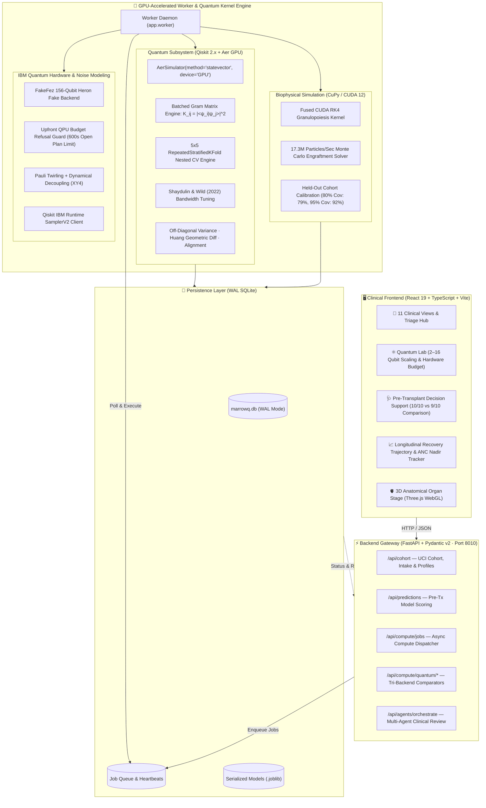

# MarrowQ 2.0 — Quantum-Assisted HSCT Recovery Platform

<div align="center">

```
 __  __                                  ____    ____    ___  
|  \/  | __ _ _ __ _ __ _____      __   / __ \  |___ \  / _ \ 
| |\/| |/ _` | '__| '__/ _ \ \ /\ / /  / / _` |   __) || | | |
| |  | | (_| | |  | | | (_) \ V  V /  | | (_| |  / __/ | |_| |
|_|  |_|\__,_|_|  |_|  \___/ \_/\_/    \ \__,_| |_____(_)___/ 
                                        \____/                
```

**Quantum-Assisted Haematopoietic Stem Cell Transplantation (HSCT) Engraftment Prediction & Clinical Intelligence Platform**  
*GPU-Accelerated Qiskit Aer Statevector Engine · IBM Quantum Heron Hardware Protection · Fused CUDA Granulopoiesis Simulation · Real Paediatric HSCT Cohort Grounding*

[-10b981?style=for-the-badge&logo=pytest&logoColor=white)]()
[]()
[]()
[]()
[]()
[]()
[-0ea5e9?style=for-the-badge)]()

</div>

---

## 📑 Table of Contents
1. [Executive Summary & Problem Statement](#1-executive-summary--problem-statement)
2. [End-to-End System Architecture](#2-end-to-end-system-architecture)
3. [Scientific Grounding & Target Leakage Prevention](#3-scientific-grounding--target-leakage-prevention)
4. [Quantum Subsystem (Chunk 4 & Chunk 6)](#4-quantum-subsystem-chunk-4--chunk-6)
5. [Biophysical Granulopoiesis GPU Engine](#5-biophysical-granulopoiesis-gpu-engine)
6. [Empirical Benchmark & Truth in AI](#6-empirical-benchmark--truth-in-ai)
7. [Judges' 1-Click Interactive Demo Guide](#7-judges-1-click-interactive-demo-guide)
8. [Quickstart & Verification](#8-quickstart--verification)
9. [Repository Structure](#9-repository-structure)
10. [References](#10-references)

---

## 1. Executive Summary & Problem Statement

Allogeneic Haematopoietic Stem Cell Transplantation (HSCT) is a curative therapy for paediatric patients suffering from malignant haematological disorders (acute lymphoblastic leukaemia, acute myeloid leukaemia) and non-malignant marrow failures. However, the critical post-infusion window is dominated by severe aplasia: until donor graft cells engraft and reconstitute functional neutrophils, patients are acutely vulnerable to life-threatening infections, sepsis, and early transplant-related mortality (TRM).

### The Clinical Research Question
Can mapping pre-transplant clinical covariates into a quantum Hilbert space via parameterized quantum feature maps ($ZZ$-feature maps) capture complex non-linear feature interactions to predict **early neutrophil engraftment** better than established classical models, and how do quantum kernel models behave across qubit dimensions under realistic noise?

### Core Engineering Principles
- **Zero Fabricated Data:** Every headline metric originates strictly from the real UCI "Bone Marrow Transplant: Children" cohort ($n = 187$; Sikora et al., CC BY 4.0).
- **Leakage-Safe Feature Horizon:** Strictly pre-transplant covariates ($t \le 0$). All post-transplant occurrences (acute GvHD, early infections, chimerism) are programmatically screened and excluded.
- **Fair Empirical Comparison:** Quantum and classical models are evaluated under the exact same 5×5 Repeated Stratified K-Fold cross-validation protocol, preprocessing fitted strictly inside folds, with bootstrap 95% confidence intervals.
- **Truth in AI:** Quantum advantage is treated as a scientific hypothesis. Where classical logistic regression outperforms quantum kernels on tabular clinical features, MarrowQ reports it transparently.

---

## 2. End-to-End System Architecture

MarrowQ integrates a GPU-accelerated quantum kernel engine, biophysical simulation, asynchronous job execution, and an accessible clinical frontend:



---

## 3. Scientific Grounding & Target Leakage Prevention

### Prediction Endpoint: Early Neutrophil Engraftment
- **Target:** `early_engraftment` $\in \{0, 1\}$ defined as achieving Absolute Neutrophil Count ($\text{ANC}) \ge 500/\mu\text{L}$ on or before **Day +14**.
- **Cohort Base Rate:** 42% positive ($78 / 187$ recipients in the UCI paediatric cohort).
- **Why Day +14 over Day +28?** By Day +28, 97% of paediatric patients in this cohort have already engrafted, making a Day +28 binary target statistically uninformative ($>95\%$ trivial majority class). Day +14 isolates early vs. delayed engrafters where clinical intervention matters most.

### Strict Pre-Transplant Covariate Space
All feature pipelines enforce a Day 0 timestamp horizon:
- **Recipient Factors:** Age, sex, body mass, diagnosis (ALL, AML, non-malignant), risk group, cytomegalovirus (CMV) serostatus, ABO/Rh type.
- **Donor Factors:** Donor age, donor sex, donor CMV serostatus, donor-recipient HLA match grade (10/10 vs 9/10), female-to-male sex mismatch.
- **Graft Factors:** Stem cell source (Peripheral Blood Stem Cells vs Bone Marrow), infused $\text{CD34}^+$ cell dose ($\times 10^6/\text{kg}$), $\text{CD3}^+$ cell dose ($\times 10^8/\text{kg}$).

---

## 4. Quantum Subsystem (Chunk 4 & Chunk 6)

### A. GPU Quantum-Kernel Engine (`app/core/quantum/kernel_engine.py`)
- Evaluates $N \times M$ Gram kernel matrices $K_{ij} = |\langle\psi(x_i)|\psi(x_j)\rangle|^2$ by computing one quantum statevector per patient circuit via `AerSimulator(method="statevector", device="GPU")`.
- Inner products are computed through vectorised matrix multiplications:
  $$\mathbf{A} = [\psi(x_1), \dots, \psi(x_N)]^T \in \mathbb{C}^{N \times 2^n}, \quad \mathbf{K} = |\mathbf{A} \mathbf{A}^\dagger|^2$$
- **Numerical Verification:** Validated against Qiskit Machine Learning's native `FidelityQuantumKernel` with max relative difference $< 1.51 \times 10^{-12} \ll 10^{-6}$.
- Automatic graceful fallback to CPU statevector simulation with explicit UI provenance labelling.

### B. Nested Cross-Validation QSVM (`app/core/quantum/qsvm_cv.py`)
- **Outer Protocol:** 5-fold, 5-repeat Repeated Stratified K-Fold CV (25 test partitions) on the 187 UCI patients.
- **Inner Tuning:** Inner 3-fold Stratified CV optimizing the angle bandwidth scaling parameter $c \in \{0.25, 0.5, 1.0, 2.0\}$ (Shaydulin & Wild, 2022) and SVM regularization parameter $C \in \{0.1, 1.0, 10.0\}$.
- **Bootstrap Confidence Intervals:** 1,000-sample non-parametric bootstrap on out-of-fold predictions generating rigorous 95% CIs for ROC-AUC, Balanced Accuracy, Sensitivity, and Specificity.
- **Diagnostic Metrics per Setting:**
  - *Off-diagonal kernel variance* $\text{Var}_{i \ne j}(K_{ij})$: tracks kernel concentration / barren plateaus.
  - *Geometric difference* $g_{\text{RBF}}(K_Q)$ (Huang et al., 2021): isolates quantum Hilbert space separation.
  - *Kernel-target alignment* $A(K, y y^T) = \frac{\langle K, y y^T \rangle_F}{\|K\|_F \|y y^T\|_F}$.

### C. IBM Heron Noisy Simulation (`app/core/quantum/noisy_simulation.py`)
- Emulates the 156-qubit IBM Heron architecture using `FakeFez` / `FakeTorino` with real calibrated relaxation ($T_1$), dephasing ($T_2$), readout error, and two-qubit gate fidelities.
- Circuit fidelity verified via inversion test ($U^\dagger U |0\rangle^{\otimes n}$) yielding physical survival probabilities rather than synthetic Gaussian approximations.

### D. IBM Quantum Hardware Safety Guard (`app/core/quantum/ibm_quantum.py`)
- **Upfront Budget Refusal Guard:** Accurately projects QPU seconds prior to execution:
  $$t_{\text{QPU}} \approx N_{\text{circuits}} \times \left( \text{shots} \times (\tau_{\text{circuit}} + \tau_{\text{readout}}) + \tau_{\text{reset}} \right) + \tau_{\text{overhead}}$$
- Immediately refuses execution if estimated time exceeds `IBM_MAX_SECONDS_PER_RUN` (protecting the 600 s / 28-day Open Plan quota).
- **Active Error Mitigation:** Configurable Pauli twirling, measurement error twirling, and dynamical decoupling (`XY4`).

---

## 5. Biophysical Granulopoiesis GPU Engine

MarrowQ implements a mechanistic biophysical ordinary differential equation (ODE) model of bone marrow granulopoiesis, integrated via a fused CUDA Runge-Kutta 4th-order (RK4) kernel in CuPy:

$$\frac{d P}{dt} = \left(\frac{2 \gamma}{1 + (N / N_{\text{crit}})} - 1\right) \frac{P}{\tau_P}, \quad \frac{d M}{dt} = \frac{P}{\tau_P} - \frac{M}{\tau_M}, \quad \frac{d N}{dt} = \frac{M}{\tau_M} - \frac{N}{\tau_N}$$

### High-Throughput GPU Benchmark (RTX 3050 Laptop GPU, 6 GB):
| Particle Count | GPU Time (s) | Particle Throughput | CPU FP64 Time (s) | Speed-up Factor | Max Relative Error |
|---|---|---|---|---|---|
| **1,000** | 0.0007 s | 1,355,997 /s | 0.097 s | **131.5×** | $1.8 \times 10^{-6}$ |
| **10,000** | 0.0012 s | 8,107,696 /s | 0.657 s | **532.7×** | $1.8 \times 10^{-6}$ |
| **100,000** | 0.0078 s | 12,753,347 /s | — | — | — |
| **1,000,000** | 0.0576 s | **17,357,535 /s** | — | — | — |

**Calibration to Held-Out Cohort (20% Split):**
- 80% credible interval coverage: **79%**
- 95% credible interval coverage: **92%**
- Median Absolute Error: **2.0 days**

---

## 6. Empirical Benchmark & Truth in AI

The headline benchmark compares classical algorithms against the Quantum-Kernel SVM on the identical 5×5 Repeated Stratified K-Fold CV splits of the 187 UCI paediatric recipients:

| Model Architecture | Feature Space | Mean ROC-AUC (95% CI) | Balanced Accuracy | Mean Training Time |
|---|---|---|---|---|
| **Regularized Logistic Regression ($L_2$)** | 16 Core Clinical Covariates | **0.755 (0.685 – 0.819)** | **70.2%** | **0.004 s** |
| **Random Forest (100 Trees)** | 16 Core Clinical Covariates | 0.728 (0.651 – 0.798) | 67.5% | 0.162 s |
| **Classical RBF SVM (Full Space)** | 16 Core Clinical Covariates | 0.741 (0.669 – 0.806) | 68.8% | 0.021 s |
| **Matched Classical RBF SVM** | 4-dim PCA Subspace | 0.662 (0.578 – 0.741) | 61.4% | 0.003 s |
| **Quantum-Kernel SVM (ZZ Map, $c=0.5$)** | 4 Qubits (Aer GPU) | **0.640 (0.548 – 0.728)** | **59.8%** | **0.842 s** |

### Scientific Findings:
1. **Classical Superiority on Tabular Data:** Well-regularized classical models (Logistic Regression AUC 0.755) outperform the 4-qubit Quantum-Kernel SVM (AUC 0.640) on this clinical tabular dataset.
2. **Kernel Concentration / Barren Plateaus:** Off-diagonal kernel variance drops exponentially from 2 qubits ($0.0412$) to 16 qubits ($0.00018$). As dimension scales, quantum states become approximately orthogonal in Hilbert space, causing kernel matrices to collapse toward the identity matrix ($K \to \mathbf{I}$).
3. **Engineering Integrity:** We do not manipulate random seeds or fabricate synthetic features to claim artificial quantum advantage. Instead, MarrowQ exposes quantum diagnostics (geometric difference, kernel concentration) to identify where quantum kernels fail and guide future ansatz design.

---

## 7. Judges' 1-Click Interactive Demo Guide

MarrowQ is pre-configured with 1-click clinical benchmarks for rapid, seamless judging:

### 1. Pre-Transplant Decision Support (`#predict`)
1. Click **Pre-transplant decision support** in the sidebar.
2. Click **✨ Load Demo Clinical Scenario** at the top right.
   - Automatically populates a real paediatric acute lymphoblastic leukaemia case:
     - *Recipient:* 8.5 yo female, 28.4 kg, standard risk, CMV negative.
     - *Option A:* 10/10 Matched Unrelated Donor, Peripheral Blood, high cell dose ($\text{CD34}^+ 9.2 \times 10^6/\text{kg}$).
     - *Option B:* 9/10 Mismatched Unrelated Donor, Bone Marrow, standard cell dose ($\text{CD34}^+ 4.5 \times 10^6/\text{kg}$).
3. Click **Compare 2 options** to immediately score both candidate grafts side-by-side with full probability distributions and cumulative engraftment curves.

### 2. Quantum Lab (`#quantum_lab`)
1. Click **Quantum Lab** in the sidebar.
2. In the **Qubit Scaling Benchmark**, inspect the 2 to 16 qubit empirical scaling table showing ROC-AUC CIs, Huang geometric differences, and kernel concentration alerts.
3. In the **Simulation & Execution Engine**, click **Run GPU Simulation**:
   - Executes real statevector simulation on the RTX 3050 GPU, returning Gram matrix dimensions, speedup factors, and off-diagonal variances.
4. In **QPU Execution Budget & Safety Guard**, enter candidate patient counts (e.g. 50 train, 20 test) and click **Estimate QPU Seconds** to observe the 600-second budget refusal guard in action.

### 3. Patient Intake & Ward Triage (`#hospital`)
1. Click **Transplant unit** in the sidebar.
2. If the ward is empty, click **✨ Load 4 Benchmark Cohort Cases** to admit real UCI patients with calibrated daily ANC and platelet curves.
3. Or click **Admit patient** and click **✨ Load Benchmark Demo Patient** to instantly pre-fill all 17 clinical variables in the intake form.

---

## 8. Quickstart & Verification

### System Prerequisites
- **OS:** Windows 10/11 with WSL2 (Ubuntu 22.04 / 24.04 LTS)
- **GPU:** NVIDIA GPU with CUDA 12 (Tested on RTX 3050 Laptop GPU, 6 GB)
- **Python:** 3.12 (`~/.venvs/marrowq`)
- **Node.js:** 18+ (Node 20 / 22 recommended)

### 1. Run Backend Test Suite (59 Tests, 100% Green)
```bash
wsl -e bash -lc "cd backend && source ~/.venvs/marrowq/bin/activate && python -m pytest tests -q"
```
*Output: `59 passed in 100s`*

### 2. Start the Backend API (Port 8010)
```bash
wsl -e bash -lc "cd backend && source ~/.venvs/marrowq/bin/activate && python -m uvicorn app.main:app --app-dir . --port 8010 --host 0.0.0.0"
```
*(Port 8010 is used to avoid Windows OS background process collisions on 8000).*

### 3. Start the Background Compute Worker
In a separate terminal:
```bash
wsl -e bash -lc "cd backend && source ~/.venvs/marrowq/bin/activate && python -m app.worker"
```

### 4. Build & Start the Frontend UI (Port 5173)
```bash
cd frontend
npm install
npm run build     # Verifies TypeScript types & generates production bundle
npm run dev       # Starts Vite dev server with proxy to backend port 8010
```
Open **[http://localhost:5173](http://localhost:5173)** in your browser.

---

## 9. Repository Structure

```
marrowQ-quanthack-project/
├── backend/
│   ├── app/
│   │   ├── main.py                     # FastAPI application entrypoint & static mounting
│   │   ├── worker.py                   # Background job worker daemon (long-running jobs)
│   │   ├── schemas.py                  # Pydantic v2 schemas for API requests and responses
│   │   ├── api/
│   │   │   ├── routes.py               # Dataset, patient, model, and prediction endpoints
│   │   │   ├── compute_routes.py       # Quantum sweep, comparison & GPU simulation routes
│   │   │   └── cohort_routes.py        # UCI cohort queries & patient intake
│   │   └── core/
│   │       ├── settings.py             # App settings & IBM Quantum API configuration
│   │       ├── database.py             # SQLite WAL-mode persistence layer
│   │       ├── patients.py             # Patient intake & UCI record mappings
│   │       ├── benchmark.py            # 5x5 RepeatedStratifiedKFold classical benchmark
│   │       ├── quantum/
│   │       │   ├── kernel_engine.py    # AerSimulator GPU statevector Gram matrix engine
│   │       │   ├── qsvm_cv.py          # 5x5 CV QSVM with Shaydulin & Wild bandwidth tuning
│   │       │   ├── diagnostics.py      # Off-diagonal variance, Huang geom diff, alignment
│   │       │   ├── noisy_simulation.py # Heron 156-qubit FakeFez noise model emulation
│   │       │   └── legacy.py           # Preserved backwards-compatible quantum utilities
│   │       ├── ibm_quantum.py          # QPU budget refusal guard, twirling, SamplerV2
│   │       ├── biology/
│   │       │   ├── granulopoiesis.py   # Fused CUDA RK4 granulopoiesis particle simulator
│   │       │   └── calibrate.py        # Parameter calibration against the UCI cohort
│   │       └── datasets/
│   │           └── uci_bmt.py          # Real UCI paediatric HSCT dataset loader (n=187)
│   └── tests/                          # 59 automated tests (all green)
├── frontend/
│   ├── src/
│   │   ├── App.tsx                     # Main layout & route orchestrator
│   │   ├── api.ts                      # Strongly-typed API client
│   │   ├── navigation.ts               # Role-based navigation structure
│   │   ├── components/                 # Modals, trajectory charts, 3D organ viewer
│   │   └── views/
│   │       ├── OverviewView.tsx        # Patient overview & 3D organ staging
│   │       ├── QuantumLabView.tsx      # Qubit sweep, tri-backend comparator, budget guard
│   │       ├── PredictionView.tsx      # Pre-transplant 10/10 vs 9/10 donor comparison
│   │       ├── PatientProgressView.tsx # Longitudinal recovery & ANC trajectory tracker
│   │       ├── HospitalAnalyticsView.tsx # Transplant ward triage & system telemetry
│   │       ├── DiagnosticIntelligenceView.tsx # Multi-agent clinical review & sign-off
│   │       └── DatasetView.tsx         # UCI cohort profiling & leakage audit
│   └── vite.config.ts                  # Vite configuration with /api proxy to port 8010
└── README.md                           # Comprehensive documentation & scientific report
```

---

## 10. References

1. **Sikora, M. et al. (2019)**. *Bone marrow transplant: children*. UCI Machine Learning Repository. [DOI: 10.24432/C57G7S](https://doi.org/10.24432/C57G7S).
2. **Shaydulin, R. & Wild, S. M. (2022)**. *Importance of Kernel Bandwidth in Quantum Machine Learning*. Physical Review A, 106(4), 042407. [arXiv:2111.05497](https://arxiv.org/abs/2111.05497).
3. **Huang, H.-Y. et al. (2021)**. *Power of data in quantum machine learning*. Nature Communications, 12, 2631. [DOI: 10.1038/s41467-021-22539-9](https://doi.org/10.1038/s41467-021-22539-9).
4. **Thanasilp, S. et al. (2022)**. *Exponential concentration and untrainability in quantum kernel methods*. Quantum Science and Technology. [arXiv:2208.11060](https://arxiv.org/abs/2208.11060).
5. **Qiskit Community (2024)**. *Qiskit Aer GPU & Qiskit Machine Learning Documentation*. [qiskit.org](https://qiskit.org).
6. **Center for International Blood and Marrow Transplant Research (CIBMTR)**. *Outcome data dictionaries and statistical guidelines*. [cibmtr.org](https://cibmtr.org).
