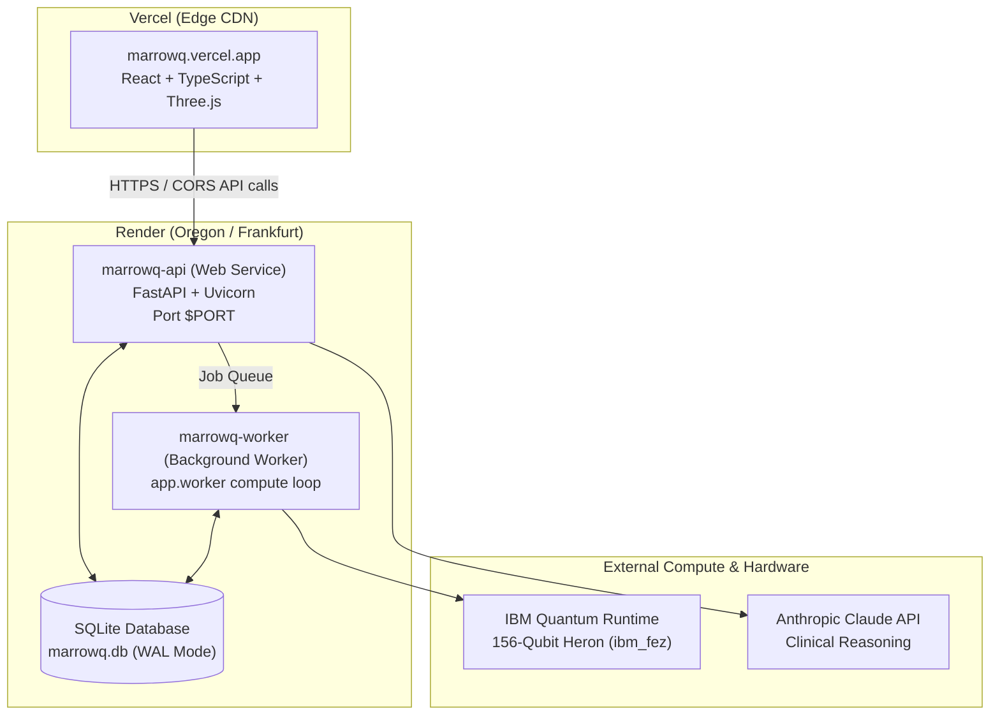

# MarrowQ — Render Cloud Backend Deployment Guide

This guide walks you through deploying the **MarrowQ FastAPI Backend** and **Background Compute Worker** to [Render](https://render.com) so the full precision medicine platform, biological intelligence modules, and Qiskit engine run 24/7 online in the cloud.

---

## Architecture Overview



---

## Method 1: Automatic 1-Click Blueprint Deploy (Recommended)

MarrowQ includes a [`render.yaml`](file:///c:/Users/nidhi/varsha/render.yaml) blueprint specification in the root of the repository.

1. **Sign in to Render:** Go to [dashboard.render.com](https://dashboard.render.com).
2. Click **New +** in the top navigation bar and select **Blueprint**.
3. Connect your GitHub repository:
   ```
   https://github.com/Nikhil-r-projects/marrowQ-quanthack-project
   ```
4. Render will automatically detect `render.yaml` and configure two services:
   - **`marrowq-api`** (Web Service, Python 3.11.9, port `$PORT`)
   - **`marrowq-worker`** (Background Worker, Python 3.11.9)
5. Under Environment Variables, enter your secret credentials:
   - `IBM_QUANTUM_TOKEN`: Your IBM Quantum API token
   - `ANTHROPIC_API_KEY`: *(Optional)* Your Anthropic Claude API key
6. Click **Apply**.
7. Render will build and deploy both services automatically!

---

## Method 2: Manual Web Service Setup

If you prefer to configure the Web Service manually via the Render UI:

### Service 1: Web Service (FastAPI)

1. Click **New +** -> **Web Service**.
2. Select repository: `Nikhil-r-projects/marrowQ-quanthack-project`.
3. Configure the following fields:
   * **Name:** `marrowq-api`
   * **Region:** `Oregon (US West)` or `Frankfurt (EU Central)`
   * **Branch:** `main`
   * **Runtime:** `Python`
   * **Build Command:**
     ```bash
     pip install --upgrade pip && pip install -r backend/requirements.txt
     ```
   * **Start Command:**
     ```bash
     uvicorn app.main:app --app-dir backend --host 0.0.0.0 --port $PORT
     ```
   * **Plan:** `Free`
4. Expand **Advanced** -> **Environment Variables**:
   * `PYTHON_VERSION` = `3.11.9`
   * `PYTHONPATH` = `backend`
   * `IBM_QUANTUM_TOKEN` = `<your-ibm-token>`
   * `ANTHROPIC_API_KEY` = `<your-anthropic-key>`
5. **Health Check Path:** `/api/health`
6. Click **Create Web Service**.

### Service 2: Background Compute Worker (Optional for Async Jobs)

1. Click **New +** -> **Background Worker**.
2. Select repository: `Nikhil-r-projects/marrowQ-quanthack-project`.
3. Configure fields:
   * **Name:** `marrowq-worker`
   * **Runtime:** `Python`
   * **Build Command:**
     ```bash
     pip install --upgrade pip && pip install -r backend/requirements.txt
     ```
   * **Start Command:**
     ```bash
     python -m app.worker
     ```
   * **Plan:** `Free`
4. Environment Variables:
   * `PYTHON_VERSION` = `3.11.9`
   * `PYTHONPATH` = `backend`
   * `IBM_QUANTUM_TOKEN` = `<your-ibm-token>`
5. Click **Create Background Worker**.

---

## Connecting Vercel Frontend to Render Backend

Once Render finishes deploying `marrowq-api`, Render will assign a public HTTPS URL:
```
https://marrowq-api.onrender.com
```

### Option A: Set Vercel Environment Variable (Instant)

1. Go to your Vercel project dashboard at [vercel.com](https://vercel.com).
2. Navigate to **Settings** -> **Environment Variables**.
3. Add a new variable:
   * **Key:** `VITE_API_BASE_URL`
   * **Value:** `https://marrowq-api.onrender.com/api` (replace with your exact Render URL)
4. Redeploy the latest commit on Vercel.

### Option B: Automatic Proxy in `vercel.json`

Add the reverse-proxy rewrite to [`vercel.json`](file:///c:/Users/nidhi/varsha/vercel.json):
```json
{
  "buildCommand": "cd frontend && npm install && npm run build",
  "outputDirectory": "frontend/dist",
  "framework": "vite",
  "rewrites": [
    {
      "source": "/api/:path*",
      "destination": "https://marrowq-api.onrender.com/api/:path*"
    },
    {
      "source": "/(.*)",
      "destination": "/index.html"
    }
  ]
}
```

---

## Verifying Deployment Health

Once deployed, probe your Render backend in your browser or terminal:

```bash
curl -s https://<your-render-app-name>.onrender.com/api/health
```

Expected JSON response:
```json
{
  "status": "healthy",
  "service": "MarrowQ API",
  "timestamp": "...",
  "versions": {
    "qiskit": "2.5.2",
    "qiskit_available": true,
    "scikit_learn": "1.9.1",
    "pandas": "3.0.5",
    "numpy": "2.5.3"
  }
}
```
