# MarrowQ Security, Privacy & Compliance Architecture

**Date:** October 31, 2026  
**Scope:** Information Security, Patient Data Protection, Regulatory Compliance, and Access Control  
**Applicable Legal Frameworks:** India Digital Personal Data Protection Act (DPDPA 2023), DISHA (Digital Information Security in Healthcare Act), HIPAA Security & Privacy Rules (45 CFR Parts 160/164), EU GDPR (Regulation 2016/679)  

---

## 1. Regulatory Compliance Framework (India DPDPA & Global Standards)

MarrowQ processes sensitive personal data (health records, genomic sequences, pathology images, biological metrics). It complies with the key tenets of the Indian Digital Personal Data Protection Act (DPDPA 2023):

| DPDPA 2023 Requirement | Technical Implementation in MarrowQ | Verification Mechanism |
| :--- | :--- | :--- |
| **Notice & Purpose Limitation (Section 5)** | Clear disclosure of clinical decision-support and research aims; data is processed solely for authorised medical analysis. | Ingestion consent logging; purpose tags attached to all data rows. |
| **Verifiable Consent (Section 6)** | Digital consent tokens recorded for clinical research cohorts; separate patient family review tier. | Consent record audit trail in `audit_events`. |
| **Data Principal Rights (Sections 11–14)** | Right to access health data, right to correction/updating, and right of grievance redressal. | Self-service patient export API (`/api/v2/patient/export`); record correction workflow. |
| **Data Protection by Design (Section 8)** | De-identification, strict RBAC, end-to-end encryption, automated audit logging. | Cryptographic key management; periodic automated security scans. |
| **Cross-Border Transfer Restrictions** | Default deployment retains patient health information within sovereign Indian data centres. | Localized cloud storage policies; on-premise execution mode for hospital deployments. |

---

## 2. Authentication & Role-Based Access Control (RBAC)

### 2.1 Password Hashing & Token Architecture
* **Password Hashing:** `argon2id` (memory cost $64\text{ MB}$, time cost $3$, parallelism $4$) or `bcrypt` (work factor $12$). Plaintext passwords or unsalted SHA-256 hashes are strictly prohibited.
* **Access Tokens:** Signed JSON Web Tokens (JWT) using `RS256` or `HS256` with 15-minute expiration.
* **Refresh Tokens:** Cryptographically random 256-bit entropy tokens stored in `user_sessions` with 7-day expiration, delivered exclusively via `HttpOnly`, `Secure`, `SameSite=Strict` cookies.

### 2.2 Role Permissions Matrix

```mermaid
graph TD
    Roles["MarrowQ Role Hierarchy"] --> Doctor["clinician_doctor"]
    Roles --> Researcher["clinical_researcher"]
    Roles --> Patient["patient_family"]
    Roles --> Admin["hospital_admin"]

    Doctor --> D1["Full Ward Review"]
    Doctor --> D2["Patient Lab Intake"]
    Doctor --> D3["Diagnostic Sign-off"]
    Doctor --> D4["Medication & Donor Access"]

    Researcher --> R1["De-identified Datasets"]
    Researcher --> R2["Model Benchmarking"]
    Researcher --> R3["Quantum Workstation"]
    Researcher --> R4["Zero Direct PHI Access"]

    Patient --> P1["Personal Plain-Language Update"]
    Patient --> P2["Recovery Trajectory Tracker"]
    Patient --> P3["Care Team Contact"]

    Admin --> A1["User Management & RBAC"]
    Admin --> A2["Hospital Analytics"]
    Admin --> A3["Audit Log Inspection"]
```

| Permission Resource | `clinician_doctor` | `clinical_researcher` | `patient_family` | `hospital_admin` |
| :--- | :---: | :---: | :---: | :---: |
| **View Identified Patient Records** | ✅ Yes | ❌ De-identified Only | ✅ Own Record Only | ❌ De-identified Only |
| **Record Clinical Observations** | ✅ Yes | ❌ Read-Only | ❌ Read-Only | ✅ Yes |
| **Execute Agent Orchestration** | ✅ Yes | ✅ De-identified Cohorts | ❌ Pre-computed Views | ❌ No |
| **Sign-off Clinical Diagnoses** | ✅ Yes (Mandatory) | ❌ No | ❌ No | ❌ No |
| **Access Quantum Lab & Sweep** | ✅ Yes | ✅ Full Access | ✅ Read-Only Summary | ✅ Telemetry View |
| **Manage Users & Inspect Audit** | ❌ No | ❌ No | ❌ No | ✅ Full Admin |

---

## 3. Patient De-Identification & Anonymization Engine

To enable clinical researchers and external machine learning pipelines to analyze patient records safely, MarrowQ implements automated **Safe Harbor De-Identification**:
1. **Name & Direct Identifiers:** Replaced with deterministic pseudo-anonymous salt hashes: `PT-` followed by a cryptographic hash.
2. **Geographic Identifiers:** Suppressed below state/country level.
3. **Dates:** Generalized to integer days relative to stem-cell infusion (`day_post_tx`), with exact calendar dates stripped.
4. **Extreme Ages:** Ages $> 89$ aggregated into a single category ($\ge 90$).
5. **Medical Record Numbers (MRN) & Contact Info:** Stripped completely during export.

---

## 4. Encryption Standards

* **In Transit:** TLS 1.3 mandatory with strong cipher suites (`TLS_AES_256_GCM_SHA384`, `TLS_CHACHA20_POLY1305_SHA256`). HSTS enabled with `max-age=31536000`.
* **At Rest:** Database files and disk volumes encrypted with AES-256 (CBC or XTS mode). Sensitive database columns (patient direct names, phone numbers) use field-level envelope encryption via AES-GCM.
* **Audit Trail:** Immutable, append-only `audit_events` table capturing actor, timestamp, IP address, action, and target entity for every clinical query.
