# MARROWQ TARGET SYSTEM ARCHITECTURE

**Document ID:** MARROWQ-ARCH-V2  
**Date:** 2026-10-31  
**Status:** Approved Master Architecture Specification  

---

## 1. High-Level Architectural Vision

MarrowQ is a modular, multimodal precision medicine and quantum diagnostic intelligence platform. It is engineered with a strict separation between:
1. **Validated Clinical Intelligence Layer:** Deterministic clinical consensus guidelines (ELN 2022, IPSS-M, Camitta, CPIC, KDIGO), high-resolution HLA matching, and validated classical scikit-learn models.
2. **Experimental Quantum ML Research Engine:** Non-diagnostic quantum kernel algorithms (Projected Quantum Kernels, Neural Quantum Kernels, VQC, IBM Quantum QPU execution) strictly isolated from autonomous medical decision-making in compliance with TRIPOD-AI and FDA CDSS regulations.

```mermaid
flowchart TD
    subgraph Client["Frontend Client (React 19 + TypeScript + Vite)"]
        UI1["Clinical Diagnostic Workstation"]
        UI2["Quantum Engraftment Research Lab"]
        UI3["Patient Progress Timeline & Milestones"]
        UI4["3D Organ & Bone Marrow Visualizer"]
    end

    subgraph API["FastAPI Backend Layer (REST + JWT Security)"]
        R1["/api/biological/* (FCS, VCF, CBC, Smears)"]
        R2["/api/disease/* (AML, MDS, SAA, Organ Workflows)"]
        R3["/api/treatment/* (Comparison, HCT-CI, Contraindications)"]
        R4["/api/pgx/* (CPIC Dosing & Drug-Drug Alerts)"]
        R5["/api/hla/* (12-Allele + DPB1 TCE + Donor Scoring)"]
        R6["/api/survival/* (Cox Models, Kaplan-Meier, Trajectory)"]
        R7["/api/quantum/* (PQK, NQK, VQC, IBM Hardware Console)"]
        R8["/api/auth/* (NIST PBKDF2 + JWT + RBAC)"]
    end

    subgraph Core["Core Processing & Analytics Engine"]
        C1["Biological Parsing & Validation Engine"]
        C2["Clinical Reasoning & Scoring Modules"]
        C3["Survival & Longitudinal Predictors"]
        C4["Quantum Model Suite & Kernel Diagnostics"]
        C5["IBM Quantum Runtime Service Manager"]
    end

    subgraph Storage["Persistence & Artifacts (Local Workspace)"]
        DB1[("SQLite Database: marrowq.db")]
        ART[("Joblib Artifacts: Models & Preprocessors")]
        AUD[("Audit Logs & Telemetry")]
    end

    Client <--> API
    API <--> Core
    Core <--> Storage
```

---

## 2. Subsystem Architecture Specifications

### 2.1 Biological Data Ingestion & Storage Architecture
- **Multi-Modal Data Adapters:**
  - `BloodPanelAdapter`: Validates CBC, white blood cell differentials, absolute neutrophil counts, platelets, and serum biochemistry against standard reference ranges and LOINC codes.
  - `BoneMarrowAdapter`: Ingests aspirate and trephine biopsy reports, cellularity percentages, blast fractions, M:E ratios, and dysplasia criteria.
  - `FlowCytometryAdapter`: Ingests binary FCS 3.0/3.1 files, parses channel headers ($FSC, SSC, CD45, CD34, CD117, CD19, CD3$), performs automated gating, and derives blast fraction and MRD sensitivity.
  - `GenomicVariantAdapter`: Parses VCF files, normalizes variants to HGVS nomenclature on GRCh38, and links to ClinVar and COSMIC annotation tables.
  - `PathologyVisionAdapter`: Ingests bone marrow smear microscopy images, applies cell segmentation algorithms, and outputs quantitative morphological summaries.

### 2.2 Clinical Disease & Treatment Intelligence Architecture
- **Hematology Registry:**
  - `AMLModule`: Implements ELN 2022 risk stratification (Favorable, Intermediate, Adverse) based on cytogenetics and mutational profile.
  - `MDSModule`: Computes Molecular IPSS-M score incorporating cytogenetic risk and mutational burdens.
  - `SAAModule`: Implements Modified Camitta criteria (Moderate, Severe, Very Severe Aplastic Anemia).
  - Expanded Modules for ALL, CML, CLL, MPN, Multiple Myeloma, and Lymphoma.
- **Cross-Organ Specialty Modules:**
  - Nephrology (CKD-EPI 2021, KDIGO AKI), Hepatology (MELD-Na, FIB-4), Cardiology (ACC/AHA ASCVD 10-yr), Neurology, Endocrinology, Solid Tumors.
- **Treatment Comparison Engine:**
  - Evaluates eligible regimens against patient age, ECOG performance status, HCT-CI score, organ function, and contraindications.
  - Generates comparative profiles for expected response rate, relapse risk, and treatment-related mortality.

### 2.3 Precision Medicine: HLA & Pharmacogenomics
- **12-Allele HLA Matching Engine:**
  - Locus-by-locus comparison: HLA-A, B, C, DRB1, DQB1, DPB1.
  - Fleischhauer DPB1 T-cell epitope (TCE) permissiveness classification (Group 1, 2, 3).
  - Donor-Specific Anti-HLA Antibody (DSA) MFI risk scoring.
  - Non-HLA donor factors: Donor age scoring, CMV serostatus mismatch risk, ABO compatibility grading, and graft source kinetics.
- **CPIC Pharmacogenomic Engine:**
  - Level A & B guideline rules for TPMT, NUDT15, CYP2C19, DPYD, UGT1A1, CYP2D6, CYP2C9, VKORC1, and HLA-B*57:01.
  - Interactive dosage adjustments based on eGFR and total bilirubin.
  - Drug-drug interaction alerts for transplant immunosuppressive regimens.

### 2.4 Longitudinal Recovery & Survival Engine
- **Survival Analytics:**
  - Kaplan-Meier survival curves for overall survival (OS) and event-free survival (EFS).
  - Cox Proportional Hazards models with hazard ratios and confidence intervals.
  - Longitudinal engraftment trajectory calibrated by graft source (PBSC $14.5\text{d}$, BM $18.5\text{d}$, CB $24.0\text{d}$), CD34+ cell dose, and age.
  - Actual vs. predicted milestone tracking with time-dependent error metrics (MAE, RMSE, Brier score).

### 2.5 Advanced Quantum Machine Learning Research Engine
- **Architectural Suite:**
  1. `FidelityQuantumKernel`: Standard statevector overlap with Shaydulin bandwidth scaling $c$ and tunable entanglement.
  2. `ProjectedQuantumKernel (PQK)`: Local Pauli-Z and Pauli-XX observables mapped to an outer classical RBF kernel. Immune to exponential concentration.
  3. `TrainableNeuralQuantumKernel (NQK)`: Parameterized data-reuploading circuit optimized via gradient ascent to maximize kernel-target alignment $A(K(\boldsymbol{\theta}), \mathbf{y})$.
  4. `VariationalQuantumClassifier (VQC)`: Differentiable parameterized circuit with parameter-shift gradients and classical cross-entropy head.
  5. `HybridQuantumStackingEnsemble`: Meta-model combining out-of-fold probability predictions from classical models and quantum kernels.
- **Kernel Diagnostics Module:**
  - Full Gram matrix heatmap, eigenvalue spectrum, condition number, off-diagonal variance (concentration check), and kernel-target alignment.
- **Hardware Integration & Error Mitigation:**
  - IBM Quantum Runtime Service connection to physical 156-qubit Heron QPUs (`ibm_fez`, `ibm_kingston`, `ibm_marrakesh`).
  - Staged execution strategy: Local Statevector $\to$ FakeFez Noisy Simulation $\to$ Guarded QPU Execution.
  - Error mitigation: Twirled Readout Error Extrapolation (TREX), Gate Twirling, Zero-Noise Extrapolation (ZNE).

### 2.6 Security, RBAC & Governance
- NIST PBKDF2-HMAC-SHA256 password hashing.
- PyJWT bearer token authorization with role claims (`doctor`, `researcher`, `patient`, `admin`).
- Database-backed clinical audit trail (`clinical_audit_logs`) tracking patient record access and QPU circuit submissions.
