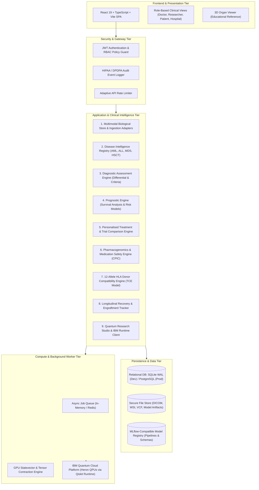

# MarrowQ Target Architecture Specification

**Date:** October 31, 2026  
**System:** MarrowQ Precision Medicine Platform  
**Architecture Style:** Modular, Multimodal, Event-Driven, Microservice-Ready Monolith with High-Performance Async Compute Workers  

---

## 1. System Context & Top-Level Architecture

MarrowQ is architected into 9 decoupled logical subsystems designed for clean separation of concerns, strict clinical provenance, and seamless extensibility across diseases and biological modalities.

---

## 2. Subsystem Detailed Specifications

### Subsystem 1: Multimodal Biological Store & Ingestion Adapters
* **Role:** Ingest, parse, validate, and store heterogeneous biological specimens and observations.
* **Component Modules:**
  - `BloodObservationAdapter`: Handles CBC, diff, chemistry, cytokines with LOINC validation.
  - `BoneMarrowSynopticAdapter`: Handles aspirate counts, core biopsy histology, fibrosis grade, and flow cytometry.
  - `GenomicVariantAdapter`: Parses VCF 4.2 files, normalizes HGVS notations, queries ClinVar/PharmGKB.
  - `DICOMImagingAdapter`: De-identifies imaging studies, extracts image metadata, prepares WSI tiles.
* **Storage Entity:** `multimodal_observations` with polymorphic `payload_json` and strict source provenance.

### Subsystem 2: Disease Intelligence Registry
* **Role:** Manages disease definitions, diagnostic criteria, biomarkers, and clinical workflows.
* **Registry Structure:**
  - Each disease module is an independent Python class inheriting from `BaseDiseaseModule`.
  - Registered Modules: `AMLModule`, `ALLModule`, `MDSModule`, `AplasticAnaemiaModule`, `MultipleMyelomaModule`, `HSCTComplicationsModule`.
  - Extension Interfaces: Plug-and-play interfaces for solid oncology (Breast, Lung, Colorectal), Nephrology (CKD, AKI), Hepatology (Cirrhosis, Fibrosis), and Cardiology.

### Subsystem 3: Diagnostic Assessment Engine
* **Role:** Synthesizes patient biological observations into differential diagnoses with supporting and contradictory evidence.
* **Operational Flow:**
  1. Gathers all recent biological observations for a patient encounter.
  2. Evaluates WHO/ICC 2022 diagnostic classification rules.
  3. Formulates differential diagnoses ranked by evidence alignment.
  4. Identifies missing investigations required for definitive confirmation (e.g. "Bone marrow biopsy shows 18% blasts; flow cytometry and $NPM1/FLT3$ molecular testing required").
  5. Leaves diagnosis in `SUSPECTED_DRAFT` until an authorized clinician signs off.

### Subsystem 4: Prognostic Intelligence Engine
* **Role:** Provides calibrated survival forecasts, relapse risk calculations, and complication forecasts.
* **Model Families:**
  - Standardized Cox Proportional Hazards (`lifelines`).
  - Random Survival Forests (`scikit-survival`).
  - Competing-Risk Fine-Gray Models (competing risk of relapse vs non-relapse mortality).
* **Guarantees:** Every prognostic endpoint specifies a time horizon (e.g. 2-year OS, 100-day NRM) and confidence intervals.

### Subsystem 5: Personalised Treatment Intelligence Engine
* **Role:** Compares evidence-supported treatment regimens tailored to patient disease subtype, molecular mutations, and organ performance.
* **Capabilities:**
  - Filters regimens against contraindications (e.g. antracyclines contraindicated in reduced LVEF $< 45\%$; high-dose cytarabine adjusted for renal impairment).
  - Summarizes expected complete remission (CR) rates and median progression-free survival from clinical trial benchmarks.
  - Highlights open, actively recruiting clinical trials matching the patient's genomic profile.

### Subsystem 6: Medication Suitability & Pharmacogenomics Engine
* **Role:** Prevents adverse drug reactions and treatment failures using patient diplotypes.
* **Integration:**
  - Direct implementation of CPIC Level A/B guidelines.
  - Gene evaluation: $TPMT, NUDT15, DPYD, CYP2C19, CYP2D6, CYP2C9, VKORC1$.
  - Generates clear action badges: `SAFE`, `DOSE_REDUCTION_REQUIRED`, `CONTRAINDICATED`, `ALTERNATIVE_RECOMMENDED`.

### Subsystem 7: 12-Allele HLA Donor Compatibility Engine
* **Role:** High-resolution donor matching and candidate ranking for allogeneic HSCT.
* **Evaluation Matrix:**
  - Allele matching at HLA-A, -B, -C, -DRB1, -DQB1, -DPB1.
  - Fleischhauer T-Cell Epitope (TCE) permissiveness for DPB1.
  - Recipient anti-HLA donor-specific antibodies (DSA) screening with MFI threshold alerts ($MFI \ge 2,000$).
  - ABO blood group compatibility classification (Major, Minor, Bidirectional).
  - Donor age, CMV serostatus concordance, and sex matching.

### Subsystem 8: Longitudinal Recovery & Engraftment Tracker
* **Role:** Comprehensive tracking of patient recovery trajectories across pre-treatment, treatment, and post-transplant phases.
* **Clinical Consensus Compliance:**
  - Strictly evaluates ASTCT criteria: Neutrophil engraftment requires 3 consecutive daily counts $\ge 500/\mu\text{L}$; Platelet engraftment requires 3 consecutive counts $\ge 20,000/\mu\text{L}$ with 7 days transfusion independence.
  - Dynamic trajectory plotting with real-time prediction-versus-observation error tracking.

### Subsystem 9: Quantum Research Studio
* **Role:** Genuine quantum computing research and benchmarking without pseudo-clinical claims.
* **Capabilities:**
  - Qiskit 2.x and IBM Quantum Runtime SamplerV2 integration.
  - GPU-accelerated quantum statevector Gram matrix engine.
  - Noise modeling using Heron FakeFez calibration properties.
  - Error mitigation: Pauli twirling, XY4 dynamical decoupling, zero-noise extrapolation.
  - Barren plateau diagnostics: monitoring exponential concentration of off-diagonal kernel variance.
  - Isolated from clinical diagnostic consensus: outputs presented in a dedicated research track.

---

## 3. Security, Multi-Tenancy & Data Protection

* **Authentication:** Password hashing via `bcrypt` / `argon2id`; JWT access tokens (15-minute expiration) with rotating refresh tokens (7-day expiration in HttpOnly cookie).
* **Role-Based Access Control (RBAC):**
  - Roles: `clinician_doctor`, `clinical_researcher`, `patient_family`, `hospital_admin`.
  - Fine-grained endpoint authorization guards: `@require_roles(["clinician_doctor"])`.
* **Data Protection Compliance:**
  - **India DPDP Act (2023):** Purpose limitation, verifiable consent, patient data de-identification, and right of data correction.
  - **HIPAA / GDPR:** AES-256 encryption at rest for sensitive health identifiers; TLS 1.3 in transit; comprehensive audit logging in `audit_events`.
